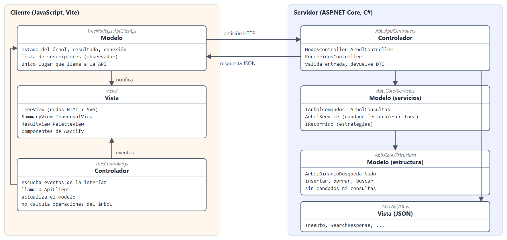
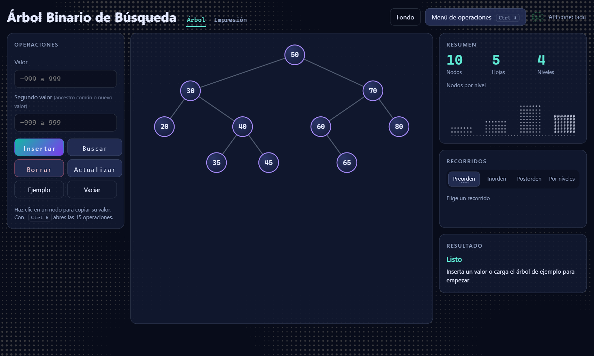
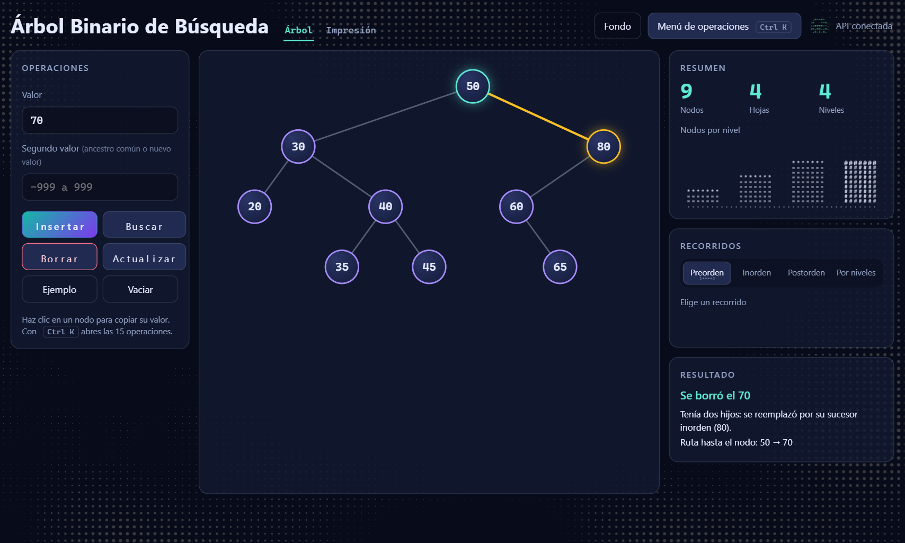
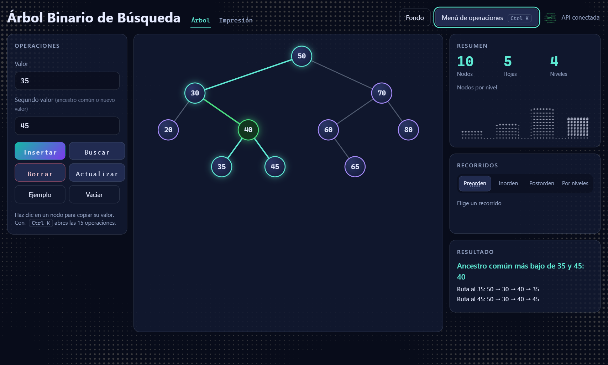
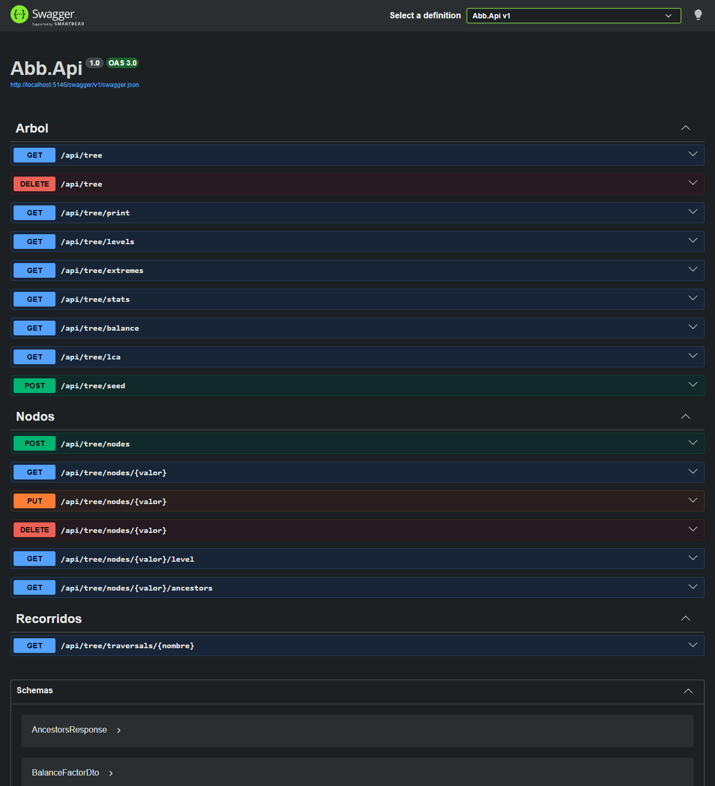

# Proyecto: Árbol Binario de Búsqueda (ABB) como aplicación web

## 1. Introducción

Este proyecto es una aplicación web para trabajar con un árbol binario de búsqueda (ABB). Lo armé en dos partes: un servidor en C# que guarda el árbol y hace todas las operaciones, y una página en JavaScript que lo dibuja y anima cada paso. Entre las dos hay una API REST.

La instrucción pide quince operaciones. Las diez primeras son las clásicas: imprimir, buscar, insertar, borrar, los cuatro recorridos, el número de niveles y el nivel de un nodo. Para las cinco libres elegí el mínimo y el máximo, el conteo de nodos y hojas, los ancestros de un nodo, la verificación de balance y el ancestro común más bajo de dos nodos. Cada una aparece con su propio título en el menú, como se pedía. Agregué además la actualización de un valor, que no estaba en la lista, solo para que la API cubra el CRUD completo.

El código está en https://github.com/Juulren/ABB.git

## 2. El ABB en pocas palabras

Un ABB guarda un valor por nodo y cumple una regla: lo que queda a la izquierda es menor, lo que queda a la derecha es mayor. Aquí no se permiten repetidos.

Buscar, insertar y borrar bajan por una sola rama, así que su costo depende de la altura. Con valores en orden aleatorio eso es O(log n) en promedio. Con valores ya ordenados el árbol se vuelve una cadena y el costo sube a O(n) (Cormen, Leiserson, Rivest y Stein). Mi árbol no se rebalancea, y por eso la operación 14 al menos avisa cuando deja de estar balanceado.

Los recorridos solo cambian el momento en que se visita la raíz: primero en preorden, en medio en inorden (por eso devuelve los valores ordenados) y al final en postorden. El de por niveles va de arriba abajo con una cola.

Borrar tiene tres casos. Una hoja simplemente se quita. Un nodo con un hijo se reemplaza por ese hijo. Uno con dos hijos recibe el valor de su sucesor inorden (el mínimo de su subárbol derecho), y el nodo que se elimina de verdad es el del sucesor.

Una aclaración para no confundirse al comparar resultados: en este proyecto la raíz está en el nivel 1 y un árbol vacío tiene 0 niveles. Otros textos empiezan a contar desde 0.

## 3. Tecnologías y estructura

El servidor usa .NET 10 con ASP.NET Core y controladores, pruebas con xUnit y Swagger (Swashbuckle) para explorar la API. El cliente es JavaScript con módulos ES, empaquetado con Vite, y los efectos visuales vienen de asciify-engine 4.33.0, que tiene licencia MIT.

De Asciify uso trece componentes: `background`, `decode`, `tabs`, `commandPalette`, `buttonLoading`, `toastStack`, `odometer`, `blockChart`, `pill`, `statusOrb`, `skeleton`, `pageDissolve` y `disintegrate`. El plan incluía también `ditherGradient`, pero al final no lo necesité.

Estos efectos piden WebGL2 con GPU. Con un renderizador por software no se montó ningún canvas y el `blockChart` lanzó un error, así que la gráfica quedó vacía. Por eso le puse un respaldo con barras HTML. Cómo se comporta el resto de la interfaz en ese modo no lo verifiqué.

```
ABB/
├─ src/Abb.Core    modelo: nodo, árbol, recorridos, consultas y servicios
├─ src/Abb.Api     controladores, DTO, Program.cs y el frontend compilado (wwwroot)
├─ src/Abb.Tests   82 pruebas xUnit
├─ web/            cliente: model, view y controller
└─ docs/           este documento y las capturas
```

## 4. Diseño de la API

Cada operación tiene su ruta bajo `/api/tree`. Imprimir es un `GET` a esa ruta (o a `/print` para la versión en texto), buscar y borrar usan `/nodes/{valor}` con `GET` y `DELETE`, e insertar es un `POST` a `/nodes`. Los cuatro recorridos cuelgan de `/traversals/` con el nombre del recorrido: `levelorder`, `preorder`, `postorder` e `inorder`. Las demás tienen una ruta con su propio nombre (`/levels`, `/extremes`, `/stats`, `/balance` y `/lca?a=&b=`), y las que preguntan por un nodo, como su nivel o sus ancestros, se cuelgan de `/nodes/{valor}`. Hay además tres rutas de apoyo: `PUT /nodes/{valor}` para actualizar, `DELETE` a `/api/tree` para vaciar el árbol y `POST` a `/seed` para cargar el ejemplo.

Tomé cuatro decisiones que conviene explicar. Los valores son enteros entre -999 y 999 y el árbol admite 1000 nodos como máximo, para que cada número quepa en su círculo y el dibujo siga siendo legible. Los errores salen como `problem+json`: 400 si el valor es inválido, 404 si el nodo no existe y 409 si está repetido. El árbol viaja como una lista plana de nodos, cada uno con su valor, su padre, su lado, su nivel y su posición inorden, porque un árbol anidado habría fallado con cadenas de más de 64 niveles, el límite de profundidad de System.Text.Json (y de paso esos datos son justo lo que necesita el dibujo). Por último, el árbol vive en memoria, sin base de datos, protegido con un candado de lectura y escritura.

El cliente no calcula nada del árbol. Solo calcula posiciones para dibujarlo, y todos los resultados vienen de la API.

## 5. MVC, POO, SOLID y CRUD

Apliqué el patrón Modelo-Vista-Controlador en las dos capas. Como el servidor responde JSON y no páginas, su vista son los DTO. En el cliente, el modelo guarda el estado y avisa a quien lo escucha, las vistas se redibujan cuando el modelo cambia, y el controlador recibe los eventos, llama a la API y actualiza el modelo. Ninguna vista llama a otra ni a la API.



En cuanto a POO, `Nodo` solo se modifica desde el modelo, los controladores conocen interfaces y no clases concretas, los cuatro recorridos implementan `IRecorrido` y `ArbolService` contiene un árbol y un candado en lugar de heredar de él.

Los cinco principios SOLID se ven así en el código. Para la responsabilidad única, `ArbolBinarioBusqueda` solo mantiene la estructura, las consultas son clases aparte y el candado vive en `ArbolService`. Para abierto y cerrado, agregar un recorrido es escribir una clase que implemente `IRecorrido` y registrarla en `Program.cs`, sin tocar lo demás; una prueba lo comprueba con un recorrido inverso. Para Liskov, cualquier `IRecorrido` se puede cambiar por otro sin alterar el uso. Para segregación de interfaces, `IArbolComandos`, `IArbolConsultas` e `IRecorrido` son pequeñas, y `RecorridosController` solo recibe la de consultas. Y para inversión de dependencias, los controladores reciben interfaces por constructor y `Program.cs` registra las clases concretas.

El CRUD queda cubierto así: crear es un `POST`, leer son todos los `GET`, actualizar es un `PUT` y borrar es un `DELETE`. En un ABB cambiar un valor equivale a borrar el viejo e insertar el nuevo, porque la posición depende del valor. `ArbolService` lo hace bajo un solo candado, y si el valor nuevo ya existe responde 409 sin cambiar nada.

## 6. Código principal

No pego todo el código, que está en el repositorio, sino las piezas que explican las decisiones. El borrado es lo más delicado del árbol: cuando el nodo tiene dos hijos busca el sucesor, copia su valor, reconecta el hijo derecho del sucesor y devuelve el camino recorrido para que la interfaz lo anime.

Archivo: `src/Abb.Core/Estructura/ArbolBinarioBusqueda.cs`

```csharp
    public BorradoResultado Borrar(int valor)
    {
        var ruta = new List<int>();
        Nodo? padre = null;
        var actual = Raiz;
        while (actual is not null && actual.Valor != valor)
        {
            ruta.Add(actual.Valor);
            padre = actual;
            actual = valor < actual.Valor ? actual.Izquierdo : actual.Derecho;
        }

        if (actual is null)
            return new BorradoResultado(false, "", null, Array.Empty<int>(), ruta);

        ruta.Add(actual.Valor);
        var vacia = Array.Empty<int>();

        if (actual.Izquierdo is not null && actual.Derecho is not null)
        {
            // Dos hijos: el sucesor inorden es el mínimo del subárbol derecho.
            var rutaSucesor = new List<int> { actual.Valor };
            var padreSucesor = actual;
            var sucesor = actual.Derecho;
            rutaSucesor.Add(sucesor.Valor);
            while (sucesor.Izquierdo is not null)
            {
                padreSucesor = sucesor;
                sucesor = sucesor.Izquierdo;
                rutaSucesor.Add(sucesor.Valor);
            }

            actual.Valor = sucesor.Valor;
            // El sucesor no tiene hijo izquierdo; su hijo derecho (si existe) sube a su lugar.
            if (padreSucesor == actual) padreSucesor.Derecho = sucesor.Derecho;
            else padreSucesor.Izquierdo = sucesor.Derecho;

            Total--;
            return new BorradoResultado(true, "dosHijos", actual.Valor, rutaSucesor, ruta);
        }

        var hijo = actual.Izquierdo ?? actual.Derecho;
        var caso = hijo is null ? "hoja" : "unHijo";
        if (padre is null) Raiz = hijo;
        else if (padre.Izquierdo == actual) padre.Izquierdo = hijo;
        else padre.Derecho = hijo;

        Total--;
        return new BorradoResultado(true, caso, null, vacia, ruta);
    }
```

Las dos interfaces separan lo que escribe de lo que lee.

Archivo: `src/Abb.Core/Servicios/Interfaces.cs`

```csharp
using Abb.Core.Modelos;

namespace Abb.Core.Servicios;

/// <summary>Operaciones que modifican el árbol (Create, Update y Delete del CRUD).</summary>
public interface IArbolComandos
{
    InsercionResultado Insertar(int valor);
    BorradoResultado Borrar(int valor);
    ActualizacionResultado Actualizar(int actual, int nuevo);
    void Vaciar();
    void Sembrar();
}

/// <summary>Operaciones de solo lectura (Read del CRUD).</summary>
public interface IArbolConsultas
{
    BusquedaResultado Buscar(int valor);
    IReadOnlyList<string> NombresRecorrido { get; }
    IReadOnlyList<int>? Recorrer(string nombre);
    NivelesResultado Niveles();
    int? Nivel(int valor);
    ExtremosResultado? Extremos();
    EstadisticasResultado Estadisticas();
    IReadOnlyList<int>? Ancestros(int valor);
    BalanceResultado Balance();
    LcaResultado AncestroComun(int a, int b);
    IReadOnlyList<NodoPlano> ObtenerNodos();
    string Imprimir();
}
```

El controlador valida la entrada, llama al servicio y traduce el resultado a un código HTTP.

Archivo: `src/Abb.Api/Controllers/NodosController.cs`

```csharp
    // Create: operación 3
    [HttpPost]
    public ActionResult<InsertResponse> Insertar([FromBody] CreateNodeRequest peticion)
    {
        if (ValidacionValor.Validar(this, peticion.Value, out var valor) is { } error) return error;

        var r = _comandos.Insertar(valor);
        if (r.LimiteAlcanzado)
            return Problem(statusCode: 400, title: "Límite de nodos",
                detail: $"El árbol admite como máximo {Limites.MaximoNodos} nodos.");
        if (!r.Insertado)
            return Problem(statusCode: 409, title: "Valor duplicado", detail: $"El valor {valor} ya existe en el árbol.");

        return Created($"/api/tree/nodes/{valor}", new InsertResponse(Mapeo.Arbol(_consultas), r.Ruta));
    }
```

En el cliente, el controlador ejecuta el borrado como una secuencia: pide la operación a la API, anima la ruta y la desintegración del nodo, y al final dibuja el árbol con la respuesta. Si una animación falla, el árbol se dibuja de todos modos.

Archivo: `web/src/controller/TreeController.js`

```javascript
  async remove(a) {
    const r = await this.api.remove(a);
    const casos = {
      hoja: 'Era una hoja: se quitó sin más.',
      unHijo: 'Tenía un hijo: el hijo ocupó su lugar.',
      dosHijos: `Tenía dos hijos: se reemplazó por su sucesor inorden (${r.successor}).`,
    };
    await this.safe(async () => {
      await walk(this.treeView, r.path);
      this.treeView.mark(a, 'target');
      if (r.case === 'dosHijos') await walk(this.treeView, r.successorPath.slice(1), 'successor');
      const el = this.treeView.nodeEl(a);
      // Sin un campo que dibuje, disintegrate podría no resolverse: se limita la espera.
      if (el) {
        await Promise.race([
          disintegrate(el, { duration: 620, collapse: false, remove: false }),
          new Promise((resolve) => setTimeout(resolve, 1800)),
        ]);
      }
    });
    this.model.setTree(r.tree);
    await this.safeSummary();
    this.model.setResult({
      title: `Se borró el ${a}`,
      lines: [casos[r.case] ?? '', `Ruta hasta el nodo: ${this.ruta(r.path)}`],
    });
  }
```

## 7. La aplicación en funcionamiento

Las capturas salen de la aplicación ejecutándose, siempre desde el árbol de ejemplo que se carga con el botón «Ejemplo»: 50, 30, 70, 20, 40, 60, 80, 35, 45 y 65. A la izquierda están el campo de valor y los botones, en el centro el árbol, y a la derecha el resumen con contadores, los recorridos y el resultado de la última operación. Con Ctrl+K se abre un menú con las quince operaciones, y cada una resalta en el árbol el camino que recorre.




Al buscar un valor, la ruta se ilumina nodo por nodo y el resultado se marca en verde. Al insertar, se recorre la ruta y después aparece el nodo nuevo.


Borrar un nodo con dos hijos es el caso más vistoso: se recorre el camino hasta el sucesor inorden, el nodo se deshace en caracteres y el sucesor ocupa su lugar.



Los recorridos numeran los nodos en el orden de visita y dejan la lista como una fila de pastillas. Una de las operaciones libres, el ancestro común más bajo, marca las dos rutas y el nodo en común.




En pantallas angostas el árbol pasa arriba y los paneles se apilan. La API, por su parte, se puede explorar en Swagger.




## 8. Pruebas y límites

Hay 82 pruebas automáticas y todas pasan: 50 del modelo y los servicios, y 32 de integración sobre la API. Cubren los tres casos de borrado (incluida la raíz y un sucesor con hijo derecho), los cuatro recorridos contra resultados calculados a mano, el árbol vacío en cada operación, el tope de 1000 nodos, los valores inválidos y una cadena de 200 niveles que se serializa sin problema.

En el navegador recorrí las quince operaciones en Chrome con GPU y la consola quedó sin errores. Una revisión posterior me hizo endurecer el cliente: si una animación falla el árbol se dibuja igual, y la espera del efecto de borrado tiene un tope de 1,8 segundos.

Lo que no probé: Firefox, Safari, un teléfono real, la navegación solo con teclado a fondo, `prefers-reduced-motion` y el .docx en Word (solo lo vi en LibreOffice). Las aristas se animan con la propiedad CSS `d`, que no probé fuera de Chrome.

Una diferencia con el plan original: al borrar un nodo con dos hijos se anima el nodo borrado, y el sucesor se desplaza solo a su nueva posición al redibujar, porque los nodos se identifican por su valor.

Limitaciones: el árbol está en la memoria del servidor (se pierde al reiniciar y lo comparten todas las personas que lo abran), el rango de valores es corto, el árbol no se rebalancea, los nodos solo responden al clic (no al teclado), con más de unos 40 nodos hay que desplazar el escenario (depende del ancho de la ventana) y Swagger solo funciona en desarrollo.

## 9. Conclusiones

Las quince operaciones funcionan, y separar la estructura de datos del transporte HTTP me permitió probarla sin levantar el servidor. Esas pruebas me dieron confianza para cambiar el borrado mientras armaba la interfaz.

Dos decisiones pesaron más de lo que esperaba. Devolver el árbol como lista plana evitó el límite de profundidad del serializador. Y dejar que el cliente no calcule nada hizo que la vista siempre se dibuje con lo que dice la API (aunque, como el árbol es compartido, otra pestaña puede cambiarlo sin que esta se entere hasta su siguiente petición).

Queda pendiente probar en más navegadores, revisar la accesibilidad con más cuidado y, si hiciera falta, rebalancear el árbol con rotaciones AVL.

## 10. Referencias

- Cormen, T. H., Leiserson, C. E., Rivest, R. L. y Stein, C. *Introduction to Algorithms*. MIT Press.
- Microsoft. Documentación de ASP.NET Core. https://learn.microsoft.com/aspnet/core (consultada en noviembre de 2026).
- Asciify. Componentes y documentación de `asciify-engine` 4.33.0. https://asciify.org/components (consultada el 18 de noviembre de 2026).
- Repositorio del proyecto: https://github.com/Juulren/ABB.git
