# Proyecto: Árbol Binario de Búsqueda (ABB) como aplicación web

Aplicación web dinámica con API REST en C# (ASP.NET Core) y frontend en JavaScript con componentes de Asciify. Repositorio: https://github.com/Juulren/ABB.git

## 1. Introducción y objetivo

El proyecto implementa un árbol binario de búsqueda (ABB) y lo muestra de forma gráfica en una aplicación web. La estructura vive en un servidor escrito en C# y se opera por medio de una API REST. La interfaz, escrita en JavaScript, dibuja el árbol, anima cada operación y muestra el resultado.

La instrucción pide quince operaciones: imprimir los elementos, buscar, insertar, borrar, los cuatro recorridos (por niveles, preorden, postorden e inorden), el número de niveles, el nivel de un nodo y cinco operaciones libres. Las cinco libres que se eligieron son el mínimo y el máximo, el conteo de nodos y hojas, los ancestros de un nodo, la verificación de balance y el ancestro común más bajo de dos nodos. Los títulos de esas cinco aparecen con nombre propio en el menú de opciones, como indica la instrucción.

Además de las quince operaciones se añadió una de actualización de valor. No está en la lista de la instrucción y se agregó para que la API cubra el ciclo completo de CRUD (crear, leer, actualizar y borrar).

## 2. Marco breve

Un árbol binario de búsqueda guarda un valor en cada nodo y cumple una regla de orden: todos los valores del subárbol izquierdo son menores que el del nodo, y todos los del derecho son mayores. En este proyecto no se admiten valores repetidos.

Buscar, insertar y borrar recorren una sola rama desde la raíz, así que su costo depende de la altura *h* del árbol. Con inserciones en orden aleatorio la altura crece de forma logarítmica y las operaciones cuestan O(log n) en promedio. Si los valores llegan ya ordenados, el árbol se convierte en una cadena, la altura es n y el costo pasa a O(n) (Cormen, Leiserson, Rivest y Stein, *Introduction to Algorithms*). La aplicación no rebalancea el árbol, y por eso incluye la operación 14, que informa si el árbol cumple el criterio AVL.

Los cuatro recorridos visitan los nodos en órdenes distintos:

- Preorden: raíz, subárbol izquierdo, subárbol derecho.
- Inorden: subárbol izquierdo, raíz, subárbol derecho. En un ABB devuelve los valores ordenados de menor a mayor.
- Postorden: subárbol izquierdo, subárbol derecho, raíz.
- Por niveles (en anchura): de arriba abajo y de izquierda a derecha, con una cola.

El borrado tiene tres casos. Si el nodo es una hoja se quita sin más. Si tiene un hijo, ese hijo ocupa su lugar. Si tiene dos, se copia el valor de su sucesor inorden (el mínimo del subárbol derecho) en el nodo y se elimina el nodo del sucesor, que como mucho tiene un hijo derecho.

**Convención de niveles.** La raíz está en el nivel 1, y el número de niveles del árbol es su altura medida en nodos. Un árbol vacío tiene 0 niveles. Otros textos cuentan desde 0, así que conviene tenerlo presente al comparar resultados.

## 3. Tecnologías

| Capa | Tecnología | Uso |
|---|---|---|
| Servidor | .NET 10 y ASP.NET Core con controladores | API REST, inyección de dependencias, `ProblemDetails` para los errores |
| Servidor | Swashbuckle (Swagger) | Documentación interactiva de la API, solo en desarrollo |
| Pruebas | xUnit y `Microsoft.AspNetCore.Mvc.Testing` | Pruebas unitarias del modelo y pruebas de integración de la API |
| Cliente | JavaScript con módulos ES y Vite | Interfaz y empaquetado. El build se copia a `wwwroot` |
| Cliente | asciify-engine 4.33.0 (licencia MIT) | Efectos y componentes con caracteres ASCII |

Componentes de Asciify que sí se usan: `background` (preset `swell`), `decode` (título y enlaces), `tabs` (selector de recorrido), `commandPalette` (menú de operaciones), `buttonLoading` (botones), `toastStack` (avisos), `odometer` (contadores), `blockChart` (nodos por nivel), `pill` (resultado de los recorridos), `statusOrb` (estado de la API), `skeleton` (carga inicial), `pageDissolve` (cambio de vista) y `disintegrate` (borrado de un nodo). El plan incluía también `ditherGradient`, que al final no se empleó.

Los efectos de Asciify necesitan WebGL2 con aceleración de GPU. En una prueba con un renderizador por software (SwiftShader) no se montó ningún canvas de Asciify y el `blockChart` lanzó un error, de modo que la gráfica quedó vacía. Por eso la gráfica de nodos por nivel tiene un respaldo con barras HTML. El comportamiento del resto de la interfaz en ese modo no se verificó.

## 4. Diseño

### 4.1 Estructura del proyecto

```
ABB/
├─ src/
│  ├─ Abb.Core/        Modelo: Nodo, ArbolBinarioBusqueda, recorridos, consultas, servicios
│  ├─ Abb.Api/         Controladores, DTO, Program.cs, wwwroot (build del frontend)
│  └─ Abb.Tests/       82 pruebas xUnit
├─ web/                Cliente: model, view, controller, estilos
├─ docs/               Este documento y las capturas
└─ PLAN_IMPLEMENTACION.md
```

### 4.2 Contrato de la API

| # | Operación | Método y ruta |
|---|---|---|
| 1 | Imprimir elementos | `GET /api/tree` y `GET /api/tree/print` |
| 2 | Buscar | `GET /api/tree/nodes/{valor}` |
| 3 | Insertar | `POST /api/tree/nodes` con `{ "value": n }` |
| 4 | Borrar | `DELETE /api/tree/nodes/{valor}` |
| 5 | Recorrido por niveles | `GET /api/tree/traversals/levelorder` |
| 6 | Recorrido preorden | `GET /api/tree/traversals/preorder` |
| 7 | Recorrido postorden | `GET /api/tree/traversals/postorder` |
| 8 | Recorrido inorden | `GET /api/tree/traversals/inorder` |
| 9 | Número de niveles | `GET /api/tree/levels` |
| 10 | Nivel de un nodo | `GET /api/tree/nodes/{valor}/level` |
| 11 | Mínimo y máximo | `GET /api/tree/extremes` |
| 12 | Contar nodos y hojas | `GET /api/tree/stats` |
| 13 | Ancestros de un nodo | `GET /api/tree/nodes/{valor}/ancestors` |
| 14 | Verificar balance | `GET /api/tree/balance` |
| 15 | Ancestro común más bajo | `GET /api/tree/lca?a={x}&b={y}` |
| Aux. | Actualizar un valor (CRUD) | `PUT /api/tree/nodes/{valor}` con `{ "newValue": n }` |
| Aux. | Vaciar y cargar ejemplo | `DELETE /api/tree` y `POST /api/tree/seed` |

### 4.3 Decisiones de diseño

- **Valores.** Enteros entre -999 y 999, sin duplicados. Un duplicado responde 409. Con ese rango el número cabe en el círculo de cada nodo.
- **Tope de nodos.** El árbol admite como máximo 1000 nodos, para que el dibujo siga siendo legible. El nodo 1001 responde 400.
- **Errores.** Los errores salen como `application/problem+json`: 400 para un valor ausente en el cuerpo JSON, decimal, desbordado o fuera de rango (una petición sin `Content-Type` responde 415), 404 para un nodo que no existe y 409 para un duplicado. Las rutas reciben `{valor}` como texto y lo validan a mano, porque con la restricción `{valor:int}` un texto no numérico daría 404 en lugar de 400.
- **Árbol en forma plana.** Las respuestas devuelven el árbol como una lista de nodos con `value`, `parent`, `side`, `level` e `inorderIndex`. Un árbol anidado habría fallado al serializar cadenas de más de 64 niveles, que es el límite de profundidad por defecto de System.Text.Json. Además, esos campos son los que necesita el dibujo.
- **Un solo árbol en memoria.** No hay base de datos. El árbol es un singleton protegido con un candado de lectura y escritura.
- **El cliente no calcula operaciones.** Solo calcula posiciones de dibujo. Los resultados vienen siempre de la API.

## 5. Arquitectura MVC y principios aplicados

El código sigue el patrón Modelo-Vista-Controlador en las dos capas. Como el servidor devuelve JSON y no páginas, su vista es la representación JSON de los resultados (los DTO), y la vista visible está en el cliente.

| Capa MVC | Servidor (C#) | Cliente (JavaScript) |
|---|---|---|
| Modelo | `Abb.Core`: `Nodo`, `ArbolBinarioBusqueda`, recorridos, consultas y `ArbolService` | `model/TreeModel.js` y `model/ApiClient.js` |
| Vista | DTO de `Abb.Api/Dtos` | `view/`: `TreeView`, `SummaryView`, `TraversalView`, `ResultView`, `PaletteView` |
| Controlador | `Abb.Api/Controllers` | `controller/TreeController.js` |

En el cliente, las vistas se suscriben al modelo y se redibujan cuando cambia (patrón observador). Ninguna vista llama a otra, y ninguna llama a la API.

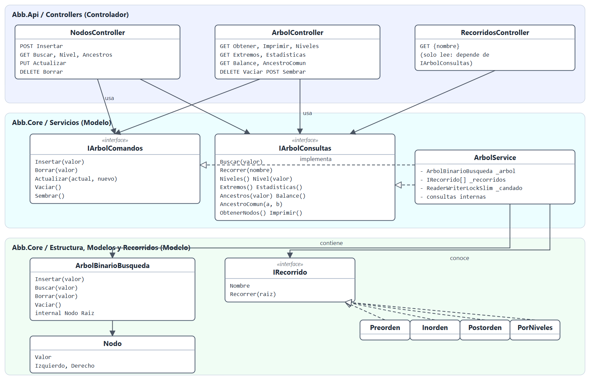


### 5.1 Programación orientada a objetos

- **Encapsulamiento.** `Nodo` tiene sus propiedades con `internal set`, de modo que solo el modelo cambia los enlaces. Los controladores reciben DTO inmutables (`record`).
- **Abstracción.** Los controladores dependen de interfaces y nunca de clases concretas.
- **Polimorfismo.** Los cuatro recorridos implementan `IRecorrido`. `ArbolService` elige uno por nombre, sin una cadena de condicionales.
- **Composición.** `ArbolService` contiene un `ArbolBinarioBusqueda` y un candado, en lugar de heredar de él.

### 5.2 Principios SOLID

| Principio | Cómo se aplica | Dónde se comprueba |
|---|---|---|
| S, responsabilidad única | `ArbolBinarioBusqueda` solo mantiene la estructura. Recorridos y consultas son clases aparte, y el candado vive en `ArbolService` | Estructura de `Abb.Core` |
| O, abierto y cerrado | Un recorrido nuevo es otra clase `IRecorrido` registrada en `Program.cs` | `SolidTests`, con un recorrido inverso de ejemplo |
| L, sustitución de Liskov | Cualquier `IRecorrido` se puede cambiar por otro sin alterar el uso | `SolidTests` |
| I, segregación de interfaces | `IArbolComandos`, `IArbolConsultas` e `IRecorrido` son pequeñas. `RecorridosController` solo recibe `IArbolConsultas` | `SolidTests` y el constructor del controlador |
| D, inversión de dependencias | Los controladores reciben interfaces por constructor y `Program.cs` registra las implementaciones | `Program.cs` |

### 5.3 CRUD

| Acción | Ruta | Operación |
|---|---|---|
| Create | `POST /api/tree/nodes` | 3, Insertar |
| Read | Todas las rutas `GET` | 1, 2 y 5 a 15 |
| Update | `PUT /api/tree/nodes/{valor}` | Añadida para completar el CRUD |
| Delete | `DELETE /api/tree/nodes/{valor}` | 4, Borrar |

En un ABB, cambiar un valor equivale a borrar el anterior e insertar el nuevo, porque la posición depende del valor. `ArbolService` lo hace con un solo candado de escritura. Si el valor nuevo ya existe responde 409 y el árbol no cambia.

## 6. Implementación del modelo

### 6.1 Nodo y estructura

Archivo: `src/Abb.Core/Modelos/Nodo.cs`

```csharp
namespace Abb.Core.Modelos;

/// <summary>Nodo del árbol. Solo el modelo puede modificar sus enlaces.</summary>
public sealed class Nodo
{
    public int Valor { get; internal set; }
    public Nodo? Izquierdo { get; internal set; }
    public Nodo? Derecho { get; internal set; }

    internal Nodo(int valor) => Valor = valor;
}
```

La clase `ArbolBinarioBusqueda` mantiene la estructura. `Insertar` y `Buscar` son iterativos y devuelven la ruta que recorrieron, que el frontend usa para animar. `Borrar` aplica los tres casos y, cuando el nodo tiene dos hijos, informa el sucesor y el camino hasta él.

Archivo: `src/Abb.Core/Estructura/ArbolBinarioBusqueda.cs`

```csharp
using Abb.Core.Modelos;

namespace Abb.Core.Estructura;

/// <summary>
/// Mantiene solo la estructura del ABB: insertar, borrar, buscar y vaciar.
/// No tiene candados ni cálculos de consulta.
/// </summary>
public sealed class ArbolBinarioBusqueda
{
    internal Nodo? Raiz { get; private set; }
    public int Total { get; private set; }

    public InsercionResultado Insertar(int valor)
    {
        var ruta = new List<int>();
        if (Raiz is null)
        {
            Raiz = new Nodo(valor);
            Total++;
            ruta.Add(valor);
            return new InsercionResultado(true, ruta);
        }

        var actual = Raiz;
        while (true)
        {
            ruta.Add(actual.Valor);
            if (valor == actual.Valor)
                return new InsercionResultado(false, ruta);

            if (valor < actual.Valor)
            {
                if (actual.Izquierdo is null)
                {
                    actual.Izquierdo = new Nodo(valor);
                    break;
                }
                actual = actual.Izquierdo;
            }
            else
            {
                if (actual.Derecho is null)
                {
                    actual.Derecho = new Nodo(valor);
                    break;
                }
                actual = actual.Derecho;
            }
        }

        Total++;
        ruta.Add(valor);
        return new InsercionResultado(true, ruta);
    }

    public BusquedaResultado Buscar(int valor)
    {
        var ruta = new List<int>();
        var actual = Raiz;
        while (actual is not null)
        {
            ruta.Add(actual.Valor);
            if (valor == actual.Valor)
                return new BusquedaResultado(true, ruta, ruta.Count);
            actual = valor < actual.Valor ? actual.Izquierdo : actual.Derecho;
        }
        return new BusquedaResultado(false, ruta, null);
    }

    public BorradoResultado Borrar(int valor)
    {
        var ruta = new List<int>();
        Nodo? padre = null;
        var actual = Raiz;
        while (actual is not null && actual.Valor != valor)
        {
            ruta.Add(actual.Valor);
            padre = actual;
            actual = valor < actual.Valor ? actual.Izquierdo : actual.Derecho;
        }

        if (actual is null)
            return new BorradoResultado(false, "", null, Array.Empty<int>(), ruta);

        ruta.Add(actual.Valor);
        var vacia = Array.Empty<int>();

        if (actual.Izquierdo is not null && actual.Derecho is not null)
        {
            // Dos hijos: el sucesor inorden es el mínimo del subárbol derecho.
            var rutaSucesor = new List<int> { actual.Valor };
            var padreSucesor = actual;
            var sucesor = actual.Derecho;
            rutaSucesor.Add(sucesor.Valor);
            while (sucesor.Izquierdo is not null)
            {
                padreSucesor = sucesor;
                sucesor = sucesor.Izquierdo;
                rutaSucesor.Add(sucesor.Valor);
            }

            actual.Valor = sucesor.Valor;
            // El sucesor no tiene hijo izquierdo; su hijo derecho (si existe) sube a su lugar.
            if (padreSucesor == actual) padreSucesor.Derecho = sucesor.Derecho;
            else padreSucesor.Izquierdo = sucesor.Derecho;

            Total--;
            return new BorradoResultado(true, "dosHijos", actual.Valor, rutaSucesor, ruta);
        }

        var hijo = actual.Izquierdo ?? actual.Derecho;
        var caso = hijo is null ? "hoja" : "unHijo";
        if (padre is null) Raiz = hijo;
        else if (padre.Izquierdo == actual) padre.Izquierdo = hijo;
        else padre.Derecho = hijo;

        Total--;
        return new BorradoResultado(true, caso, null, vacia, ruta);
    }

    public void Vaciar()
    {
        Raiz = null;
        Total = 0;
    }
}
```

### 6.2 Recorridos

Los recorridos usan pila o cola explícitas en lugar de recursión, así que un árbol degenerado de 1000 nodos no consume la pila de llamadas. Se muestran el contrato y dos de las cuatro clases.

Archivo: `src/Abb.Core/Recorridos/IRecorrido.cs`

```csharp
using Abb.Core.Modelos;

namespace Abb.Core.Recorridos;

/// <summary>Estrategia de recorrido. Un recorrido nuevo es una clase nueva, sin tocar las demás.</summary>
public interface IRecorrido
{
    string Nombre { get; }
    IReadOnlyList<int> Recorrer(Nodo? raiz);
}
```

Archivo: `src/Abb.Core/Recorridos/Inorden.cs`

```csharp
using Abb.Core.Modelos;

namespace Abb.Core.Recorridos;

public sealed class Inorden : IRecorrido
{
    public string Nombre => "inorder";

    public IReadOnlyList<int> Recorrer(Nodo? raiz)
    {
        var resultado = new List<int>();
        var pila = new Stack<Nodo>();
        var actual = raiz;
        while (actual is not null || pila.Count > 0)
        {
            while (actual is not null)
            {
                pila.Push(actual);
                actual = actual.Izquierdo;
            }
            actual = pila.Pop();
            resultado.Add(actual.Valor);
            actual = actual.Derecho;
        }
        return resultado;
    }
}
```

Archivo: `src/Abb.Core/Recorridos/PorNiveles.cs`

```csharp
using Abb.Core.Modelos;

namespace Abb.Core.Recorridos;

public sealed class PorNiveles : IRecorrido
{
    public string Nombre => "levelorder";

    public IReadOnlyList<int> Recorrer(Nodo? raiz)
    {
        var resultado = new List<int>();
        var cola = new Queue<Nodo>();
        if (raiz is not null) cola.Enqueue(raiz);
        while (cola.Count > 0)
        {
            var n = cola.Dequeue();
            resultado.Add(n.Valor);
            if (n.Izquierdo is not null) cola.Enqueue(n.Izquierdo);
            if (n.Derecho is not null) cola.Enqueue(n.Derecho);
        }
        return resultado;
    }
}
```

### 6.3 Consultas

Cada consulta es una clase pequeña que lee el árbol sin modificarlo. Se muestran las dos más elaboradas: el balance, que calcula las alturas en un solo recorrido postorden en lugar de recalcularlas nodo por nodo, y el ancestro común más bajo, que desciende desde la raíz mientras ambos valores caigan del mismo lado.

Archivo: `src/Abb.Core/Consultas/Consultas.cs`

```csharp
internal sealed class BalanceConsulta
{
    /// <summary>Definición AVL en un solo recorrido postorden: la diferencia de alturas es como máximo 1 en cada nodo.</summary>
    public BalanceResultado Ejecutar(Nodo? raiz)
    {
        var factores = new List<FactorNodo>();
        var balanceado = true;
        var alturas = new Dictionary<Nodo, int>();
        var pila = new Stack<(Nodo Nodo, bool Visitado)>();
        if (raiz is not null) pila.Push((raiz, false));
        while (pila.Count > 0)
        {
            var (n, visitado) = pila.Pop();
            if (!visitado)
            {
                pila.Push((n, true));
                if (n.Derecho is not null) pila.Push((n.Derecho, false));
                if (n.Izquierdo is not null) pila.Push((n.Izquierdo, false));
                continue;
            }
            var hi = n.Izquierdo is null ? 0 : alturas[n.Izquierdo];
            var hd = n.Derecho is null ? 0 : alturas[n.Derecho];
            alturas[n] = 1 + Math.Max(hi, hd);
            var factor = hi - hd;
            if (Math.Abs(factor) > 1) balanceado = false;
            factores.Add(new FactorNodo(n.Valor, factor));
        }
        return new BalanceResultado(balanceado, factores);
    }
}

internal sealed class LcaConsulta
{
    /// <param name="rutaDe">Devuelve el camino de la raíz al nodo (incluido), o nulo si no existe.</param>
    public LcaResultado Ejecutar(Nodo? raiz, int a, int b, Func<int, IReadOnlyList<int>?> rutaDe)
    {
        var rutaA = rutaDe(a);
        var rutaB = rutaDe(b);
        var faltantes = new List<int>();
        if (rutaA is null) faltantes.Add(a);
        if (rutaB is null && b != a) faltantes.Add(b);
        if (faltantes.Count > 0)
            return new LcaResultado(null, rutaA ?? Array.Empty<int>(), rutaB ?? Array.Empty<int>(), faltantes);

        var n = raiz!;
        while (true)
        {
            if (a < n.Valor && b < n.Valor && n.Izquierdo is not null) n = n.Izquierdo;
            else if (a > n.Valor && b > n.Valor && n.Derecho is not null) n = n.Derecho;
            else break;
        }
        return new LcaResultado(n.Valor, rutaA!, rutaB!, Array.Empty<int>());
    }
}
```

### 6.4 Interfaces y servicio

Archivo: `src/Abb.Core/Servicios/Interfaces.cs`

```csharp
using Abb.Core.Modelos;

namespace Abb.Core.Servicios;

/// <summary>Operaciones que modifican el árbol (Create, Update y Delete del CRUD).</summary>
public interface IArbolComandos
{
    InsercionResultado Insertar(int valor);
    BorradoResultado Borrar(int valor);
    ActualizacionResultado Actualizar(int actual, int nuevo);
    void Vaciar();
    void Sembrar();
}

/// <summary>Operaciones de solo lectura (Read del CRUD).</summary>
public interface IArbolConsultas
{
    BusquedaResultado Buscar(int valor);
    IReadOnlyList<string> NombresRecorrido { get; }
    IReadOnlyList<int>? Recorrer(string nombre);
    NivelesResultado Niveles();
    int? Nivel(int valor);
    ExtremosResultado? Extremos();
    EstadisticasResultado Estadisticas();
    IReadOnlyList<int>? Ancestros(int valor);
    BalanceResultado Balance();
    LcaResultado AncestroComun(int a, int b);
    IReadOnlyList<NodoPlano> ObtenerNodos();
    string Imprimir();
}
```

`ArbolService` implementa las dos interfaces, guarda el árbol y las estrategias de recorrido, y protege todo con un `ReaderWriterLockSlim`: las lecturas toman el candado de lectura y las escrituras el de escritura. Así un recorrido no corre mientras otra petición cambia el árbol.

Archivo: `src/Abb.Core/Servicios/ArbolService.cs`

```csharp
using Abb.Core.Consultas;
using Abb.Core.Estructura;
using Abb.Core.Modelos;
using Abb.Core.Recorridos;

namespace Abb.Core.Servicios;

/// <summary>
/// Coordina el árbol, las estrategias de recorrido y la concurrencia.
/// Las lecturas toman el candado de lectura y las escrituras el de escritura.
/// </summary>
public sealed class ArbolService : IArbolComandos, IArbolConsultas
{
    private static readonly int[] Ejemplo = { 50, 30, 70, 20, 40, 60, 80, 35, 45, 65 };

    private readonly ArbolBinarioBusqueda _arbol;
    private readonly Dictionary<string, IRecorrido> _recorridos;
    private readonly ReaderWriterLockSlim _candado = new();

    private readonly NivelesConsulta _niveles = new();
    private readonly ExtremosConsulta _extremos = new();
    private readonly EstadisticasConsulta _estadisticas = new();
    private readonly AncestrosConsulta _ancestros = new();
    private readonly BalanceConsulta _balance = new();
    private readonly LcaConsulta _lca = new();
    private readonly AplanadoConsulta _aplanado = new();
    private readonly ImpresionConsulta _impresion = new();

    public ArbolService(ArbolBinarioBusqueda arbol, IEnumerable<IRecorrido> recorridos)
    {
        _arbol = arbol;
        _recorridos = recorridos.ToDictionary(r => r.Nombre, StringComparer.OrdinalIgnoreCase);
    }

    // ---- Comandos ----

    public InsercionResultado Insertar(int valor)
    {
        _candado.EnterWriteLock();
        try
        {
            if (_arbol.Total >= Limites.MaximoNodos && !_arbol.Buscar(valor).Encontrado)
                return new InsercionResultado(false, Array.Empty<int>(), LimiteAlcanzado: true);
            return _arbol.Insertar(valor);
        }
        finally { _candado.ExitWriteLock(); }
    }

    public BorradoResultado Borrar(int valor)
    {
        _candado.EnterWriteLock();
        try { return _arbol.Borrar(valor); }
        finally { _candado.ExitWriteLock(); }
    }

    public ActualizacionResultado Actualizar(int actual, int nuevo)
    {
        _candado.EnterWriteLock();
        try
        {
            if (!_arbol.Buscar(actual).Encontrado)
                return new ActualizacionResultado(EstadoActualizacion.NoExiste);
            if (actual == nuevo)
                return new ActualizacionResultado(EstadoActualizacion.Actualizado);
            if (_arbol.Buscar(nuevo).Encontrado)
                return new ActualizacionResultado(EstadoActualizacion.Duplicado);
            _arbol.Borrar(actual);
            _arbol.Insertar(nuevo);
            return new ActualizacionResultado(EstadoActualizacion.Actualizado);
        }
        finally { _candado.ExitWriteLock(); }
    }

    public void Vaciar()
    {
        _candado.EnterWriteLock();
        try { _arbol.Vaciar(); }
        finally { _candado.ExitWriteLock(); }
    }

    public void Sembrar()
    {
        _candado.EnterWriteLock();
        try
        {
            _arbol.Vaciar();
            foreach (var v in Ejemplo) _arbol.Insertar(v);
        }
        finally { _candado.ExitWriteLock(); }
    }

    // ---- Consultas ----

    public BusquedaResultado Buscar(int valor) => Leer(() => _arbol.Buscar(valor));

    public IReadOnlyList<string> NombresRecorrido => _recorridos.Keys.ToList();

    public IReadOnlyList<int>? Recorrer(string nombre) =>
        _recorridos.TryGetValue(nombre, out var r) ? Leer(() => r.Recorrer(_arbol.Raiz)) : null;

    public NivelesResultado Niveles() => Leer(() => _niveles.Ejecutar(_arbol.Raiz));

    public int? Nivel(int valor) => Leer(() => _arbol.Buscar(valor).Nivel);

    public ExtremosResultado? Extremos() => Leer(() => _extremos.Ejecutar(_arbol.Raiz));

    public EstadisticasResultado Estadisticas() => Leer(() => _estadisticas.Ejecutar(_arbol.Raiz));

    public IReadOnlyList<int>? Ancestros(int valor) => Leer(() => _ancestros.Ejecutar(_arbol.Raiz, valor));

    public BalanceResultado Balance() => Leer(() => _balance.Ejecutar(_arbol.Raiz));

    public LcaResultado AncestroComun(int a, int b) => Leer(() =>
        _lca.Ejecutar(_arbol.Raiz, a, b, v =>
        {
            var r = _arbol.Buscar(v);
            return r.Encontrado ? r.Ruta : null;
        }));

    public IReadOnlyList<NodoPlano> ObtenerNodos() => Leer(() => _aplanado.Ejecutar(_arbol.Raiz));

    public string Imprimir() => Leer(() => _impresion.Ejecutar(_arbol.Raiz));

    private T Leer<T>(Func<T> lectura)
    {
        _candado.EnterReadLock();
        try { return lectura(); }
        finally { _candado.ExitReadLock(); }
    }
}
```

## 7. Implementación de los controladores y la API

`NodosController` agrupa el CRUD de nodos y las consultas sobre un nodo. Valida el valor con una clase auxiliar y traduce los resultados del servicio a códigos HTTP.

Archivo: `src/Abb.Api/Controllers/NodosController.cs`

```csharp
using Abb.Api.Dtos;
using Abb.Core.Modelos;
using Abb.Core.Servicios;
using Microsoft.AspNetCore.Mvc;

namespace Abb.Api.Controllers;

/// <summary>CRUD de nodos y consultas sobre un nodo concreto.</summary>
[ApiController]
[Route("api/tree/nodes")]
public sealed class NodosController : ControllerBase
{
    private readonly IArbolComandos _comandos;
    private readonly IArbolConsultas _consultas;

    public NodosController(IArbolComandos comandos, IArbolConsultas consultas)
    {
        _comandos = comandos;
        _consultas = consultas;
    }

    // Create: operación 3
    [HttpPost]
    public ActionResult<InsertResponse> Insertar([FromBody] CreateNodeRequest peticion)
    {
        if (ValidacionValor.Validar(this, peticion.Value, out var valor) is { } error) return error;

        var r = _comandos.Insertar(valor);
        if (r.LimiteAlcanzado)
            return Problem(statusCode: 400, title: "Límite de nodos",
                detail: $"El árbol admite como máximo {Limites.MaximoNodos} nodos.");
        if (!r.Insertado)
            return Problem(statusCode: 409, title: "Valor duplicado", detail: $"El valor {valor} ya existe en el árbol.");

        return Created($"/api/tree/nodes/{valor}", new InsertResponse(Mapeo.Arbol(_consultas), r.Ruta));
    }

    // Read: operación 2
    [HttpGet("{valor}")]
    public ActionResult<SearchResponse> Buscar(string valor)
    {
        if (ValidacionValor.Validar(this, valor, out var v) is { } error) return error;
        var r = _consultas.Buscar(v);
        return new SearchResponse(r.Encontrado, r.Ruta, r.Nivel);
    }

    // Update: operación auxiliar para completar el CRUD
    [HttpPut("{valor}")]
    public ActionResult<UpdateResponse> Actualizar(string valor, [FromBody] UpdateNodeRequest peticion)
    {
        if (ValidacionValor.Validar(this, valor, out var actual) is { } e1) return e1;
        if (ValidacionValor.Validar(this, peticion.NewValue, out var nuevo, "newValue") is { } e2) return e2;

        return _comandos.Actualizar(actual, nuevo).Estado switch
        {
            EstadoActualizacion.NoExiste =>
                Problem(statusCode: 404, title: "Nodo inexistente", detail: $"El valor {actual} no existe en el árbol."),
            EstadoActualizacion.Duplicado =>
                Problem(statusCode: 409, title: "Valor duplicado", detail: $"El valor {nuevo} ya existe en el árbol."),
            _ => new UpdateResponse(Mapeo.Arbol(_consultas)),
        };
    }

    // Delete: operación 4
    [HttpDelete("{valor}")]
    public ActionResult<DeleteResponse> Borrar(string valor)
    {
        if (ValidacionValor.Validar(this, valor, out var v) is { } error) return error;
        var r = _comandos.Borrar(v);
        if (!r.Borrado)
            return Problem(statusCode: 404, title: "Nodo inexistente", detail: $"El valor {v} no existe en el árbol.");
        return new DeleteResponse(Mapeo.Arbol(_consultas), r.Caso, r.Sucesor, r.RutaSucesor, r.Ruta);
    }

    // Operación 10
    [HttpGet("{valor}/level")]
    public ActionResult<LevelResponse> Nivel(string valor)
    {
        if (ValidacionValor.Validar(this, valor, out var v) is { } error) return error;
        var nivel = _consultas.Nivel(v);
        return nivel is null
            ? Problem(statusCode: 404, title: "Nodo inexistente", detail: $"El valor {v} no existe en el árbol.")
            : new LevelResponse(v, nivel.Value);
    }

    // Operación 13
    [HttpGet("{valor}/ancestors")]
    public ActionResult<AncestorsResponse> Ancestros(string valor)
    {
        if (ValidacionValor.Validar(this, valor, out var v) is { } error) return error;
        var ancestros = _consultas.Ancestros(v);
        return ancestros is null
            ? Problem(statusCode: 404, title: "Nodo inexistente", detail: $"El valor {v} no existe en el árbol.")
            : new AncestorsResponse(v, ancestros);
    }
}
```

`ArbolController` atiende lo que se refiere al árbol completo. `RecorridosController` solo lee, y por eso recibe únicamente `IArbolConsultas`.

Archivo: `src/Abb.Api/Controllers/ArbolController.cs`

```csharp
using Abb.Api.Dtos;
using Abb.Core.Servicios;
using Microsoft.AspNetCore.Mvc;

namespace Abb.Api.Controllers;

/// <summary>Consultas y acciones sobre el árbol completo.</summary>
[ApiController]
[Route("api/tree")]
public sealed class ArbolController : ControllerBase
{
    private readonly IArbolComandos _comandos;
    private readonly IArbolConsultas _consultas;

    public ArbolController(IArbolComandos comandos, IArbolConsultas consultas)
    {
        _comandos = comandos;
        _consultas = consultas;
    }

    // Operación 1
    [HttpGet]
    public ActionResult<TreeDto> Obtener() => Mapeo.Arbol(_consultas);

    [HttpGet("print")]
    public ActionResult<PrintResponse> Imprimir() => new PrintResponse(_consultas.Imprimir());

    // Operación 9
    [HttpGet("levels")]
    public ActionResult<LevelsResponse> Niveles()
    {
        var r = _consultas.Niveles();
        return new LevelsResponse(r.Niveles, r.PorNivel);
    }

    // Operación 11
    [HttpGet("extremes")]
    public ActionResult<ExtremesResponse> Extremos()
    {
        var r = _consultas.Extremos();
        return r is null
            ? Problem(statusCode: 404, title: "Árbol vacío", detail: "El árbol vacío no tiene mínimo ni máximo.")
            : new ExtremesResponse(r.Min, r.RutaMin, r.Max, r.RutaMax);
    }

    // Operación 12
    [HttpGet("stats")]
    public ActionResult<StatsResponse> Estadisticas()
    {
        var r = _consultas.Estadisticas();
        return new StatsResponse(r.Nodos, r.Hojas, r.Internos);
    }

    // Operación 14
    [HttpGet("balance")]
    public ActionResult<BalanceResponse> Balance()
    {
        var r = _consultas.Balance();
        return new BalanceResponse(r.Balanceado, r.Factores.Select(f => new BalanceFactorDto(f.Valor, f.Factor)).ToList());
    }

    // Operación 15
    [HttpGet("lca")]
    public ActionResult<LcaResponse> AncestroComun([FromQuery] string? a, [FromQuery] string? b)
    {
        if (ValidacionValor.Validar(this, a, out var va, "parámetro a") is { } e1) return e1;
        if (ValidacionValor.Validar(this, b, out var vb, "parámetro b") is { } e2) return e2;

        if (_consultas.Estadisticas().Nodos == 0)
            return Problem(statusCode: 404, title: "Árbol vacío", detail: "El árbol está vacío.");

        var r = _consultas.AncestroComun(va, vb);
        if (r.Valor is null)
            return Problem(statusCode: 404, title: "Nodo inexistente",
                detail: $"No existe en el árbol: {string.Join(", ", r.Faltantes)}.");
        return new LcaResponse(r.Valor.Value, r.RutaA, r.RutaB);
    }

    [HttpDelete]
    public ActionResult<TreeDto> Vaciar()
    {
        _comandos.Vaciar();
        return Mapeo.Arbol(_consultas);
    }

    [HttpPost("seed")]
    public ActionResult<TreeDto> Sembrar()
    {
        _comandos.Sembrar();
        return Mapeo.Arbol(_consultas);
    }
}
```

Archivo: `src/Abb.Api/Controllers/RecorridosController.cs`

```csharp
using Abb.Api.Dtos;
using Abb.Core.Servicios;
using Microsoft.AspNetCore.Mvc;

namespace Abb.Api.Controllers;

/// <summary>Recorridos (operaciones 5 a 8). Solo lee, así que depende únicamente de IArbolConsultas.</summary>
[ApiController]
[Route("api/tree/traversals")]
public sealed class RecorridosController : ControllerBase
{
    private readonly IArbolConsultas _consultas;

    public RecorridosController(IArbolConsultas consultas) => _consultas = consultas;

    [HttpGet("{nombre}")]
    public ActionResult<TraversalResponse> Recorrer(string nombre)
    {
        var valores = _consultas.Recorrer(nombre);
        return valores is null
            ? Problem(statusCode: 404, title: "Recorrido desconocido",
                detail: $"Recorridos disponibles: {string.Join(", ", _consultas.NombresRecorrido)}.")
            : new TraversalResponse(nombre.ToLowerInvariant(), valores);
    }
}
```

La validación de valores es común a los controladores.

Archivo: `src/Abb.Api/Controllers/ValidacionValor.cs`

```csharp
using System.Globalization;
using Abb.Core.Modelos;
using Microsoft.AspNetCore.Mvc;

namespace Abb.Api.Controllers;

internal static class ValidacionValor
{
    /// <summary>Valida un valor recibido como texto. Devuelve un 400 con ProblemDetails si no es válido.</summary>
    public static ActionResult? Validar(ControllerBase c, string? texto, out int valor, string campo = "valor")
    {
        valor = 0;
        if (string.IsNullOrWhiteSpace(texto) ||
            !int.TryParse(texto, NumberStyles.AllowLeadingSign, CultureInfo.InvariantCulture, out valor))
        {
            return c.Problem(
                statusCode: StatusCodes.Status400BadRequest,
                title: "Valor no válido",
                detail: $"El {campo} debe ser un número entero.");
        }
        return Rango(c, valor, campo);
    }

    public static ActionResult? Validar(ControllerBase c, int? numero, out int valor, string campo = "value")
    {
        valor = numero ?? 0;
        if (numero is null)
        {
            return c.Problem(
                statusCode: StatusCodes.Status400BadRequest,
                title: "Valor no válido",
                detail: $"Falta el campo '{campo}'.");
        }
        return Rango(c, valor, campo);
    }

    private static ActionResult? Rango(ControllerBase c, int valor, string campo) =>
        valor is < Limites.ValorMinimo or > Limites.ValorMaximo
            ? c.Problem(
                statusCode: StatusCodes.Status400BadRequest,
                title: "Valor fuera de rango",
                detail: $"El {campo} debe estar entre {Limites.ValorMinimo} y {Limites.ValorMaximo}.")
            : null;
}
```

Los DTO definen lo que sale al cliente. Sus nombres coinciden con el contrato de la sección 4.2.

Archivo: `src/Abb.Api/Dtos/Dtos.cs`

```csharp
public sealed record NodeDto(int Value, int? Parent, string? Side, int Level, int InorderIndex);
public sealed record TreeDto(IReadOnlyList<NodeDto> Nodes, int Count);

public sealed record InsertResponse(TreeDto Tree, IReadOnlyList<int> Path);
public sealed record SearchResponse(bool Found, IReadOnlyList<int> Path, int? Level);
public sealed record DeleteResponse(
    TreeDto Tree, string Case, int? Successor, IReadOnlyList<int> SuccessorPath, IReadOnlyList<int> Path);
public sealed record UpdateResponse(TreeDto Tree);
public sealed record LevelsResponse(int Levels, IReadOnlyList<int> PerLevel);
public sealed record LevelResponse(int Value, int Level);
public sealed record ExtremesResponse(int Min, IReadOnlyList<int> MinPath, int Max, IReadOnlyList<int> MaxPath);
public sealed record StatsResponse(int Nodes, int Leaves, int InternalNodes);
public sealed record AncestorsResponse(int Value, IReadOnlyList<int> Ancestors);
public sealed record BalanceFactorDto(int Value, int Factor);
public sealed record BalanceResponse(bool Balanced, IReadOnlyList<BalanceFactorDto> Factors);
public sealed record LcaResponse(int Value, IReadOnlyList<int> PathA, IReadOnlyList<int> PathB);
public sealed record TraversalResponse(string Name, IReadOnlyList<int> Values);
public sealed record PrintResponse(string Text);
```

`Program.cs` registra las dependencias, sirve el frontend compilado desde `wwwroot` y activa Swagger en desarrollo.

Archivo: `src/Abb.Api/Program.cs`

```csharp
using Abb.Core.Estructura;
using Abb.Core.Recorridos;
using Abb.Core.Servicios;

var builder = WebApplication.CreateBuilder(args);

builder.Services.AddControllers();
builder.Services.AddProblemDetails();
builder.Services.AddEndpointsApiExplorer();
builder.Services.AddSwaggerGen();

// Inyección de dependencias: los controladores solo conocen las interfaces.
builder.Services.AddSingleton<ArbolBinarioBusqueda>();
builder.Services.AddSingleton<IRecorrido, Preorden>();
builder.Services.AddSingleton<IRecorrido, Inorden>();
builder.Services.AddSingleton<IRecorrido, Postorden>();
builder.Services.AddSingleton<IRecorrido, PorNiveles>();
builder.Services.AddSingleton<ArbolService>();
builder.Services.AddSingleton<IArbolComandos>(sp => sp.GetRequiredService<ArbolService>());
builder.Services.AddSingleton<IArbolConsultas>(sp => sp.GetRequiredService<ArbolService>());

var app = builder.Build();

if (app.Environment.IsDevelopment())
{
    app.UseSwagger();
    app.UseSwaggerUI();
}

app.UseExceptionHandler();
app.UseStatusCodePages();

// El build del frontend se copia a wwwroot, así que `dotnet run` sirve todo.
app.UseDefaultFiles();
app.UseStaticFiles();

app.MapControllers();

app.Run();

// Necesario para WebApplicationFactory en las pruebas de integración.
public partial class Program;
```

Ejemplo de una petición y su respuesta. Insertar el valor 55 en el árbol de ejemplo:

```
POST /api/tree/nodes
{ "value": 55 }

201 Created
{
  "tree": { "nodes": [ { "value": 20, "parent": 30, "side": "left", "level": 3, "inorderIndex": 0 }, ... ], "count": 11 },
  "path": [50, 70, 60, 55]
}
```

Un duplicado devuelve `409` con `application/problem+json`, y un valor como `1.5` o `5000` devuelve `400`. La figura siguiente muestra los endpoints en Swagger.


## 8. Implementación del frontend

El cliente se organiza en modelo, vistas y controlador. `ApiClient` es el único archivo que llama a `fetch`, y traduce los errores `ProblemDetails` a una clase `ApiError`.

Archivo: `web/src/model/ApiClient.js`

```javascript
// Modelo (cliente): único lugar que habla con la API REST.

export class ApiError extends Error {
  constructor(status, title, detail) {
    super(detail || title);
    this.status = status;
    this.title = title;
    this.detail = detail;
  }
}

async function request(method, url, body) {
  let res;
  try {
    res = await fetch(url, {
      method,
      headers: body !== undefined ? { 'Content-Type': 'application/json' } : undefined,
      body: body !== undefined ? JSON.stringify(body) : undefined,
    });
  } catch {
    throw new ApiError(0, 'Sin conexión', 'No se pudo conectar con la API. Verifica que esté en ejecución.');
  }

  const text = await res.text();
  let data = null;
  try {
    data = text ? JSON.parse(text) : null;
  } catch {
    data = null;
  }

  if (!res.ok) {
    const detail = data?.detail ?? (data?.errors ? 'El valor enviado no es válido.' : 'La API respondió con un error.');
    throw new ApiError(res.status, data?.title ?? res.statusText, detail);
  }
  return data;
}

export class ApiClient {
  constructor(base = '/api/tree') {
    this.base = base;
  }

  getTree() { return request('GET', this.base); }
  print() { return request('GET', `${this.base}/print`); }
  search(value) { return request('GET', `${this.base}/nodes/${value}`); }
  insert(value) { return request('POST', `${this.base}/nodes`, { value }); }
  update(value, newValue) { return request('PUT', `${this.base}/nodes/${value}`, { newValue }); }
  remove(value) { return request('DELETE', `${this.base}/nodes/${value}`); }
  traversal(name) { return request('GET', `${this.base}/traversals/${name}`); }
  levels() { return request('GET', `${this.base}/levels`); }
  level(value) { return request('GET', `${this.base}/nodes/${value}/level`); }
  extremes() { return request('GET', `${this.base}/extremes`); }
  stats() { return request('GET', `${this.base}/stats`); }
  ancestors(value) { return request('GET', `${this.base}/nodes/${value}/ancestors`); }
  balance() { return request('GET', `${this.base}/balance`); }
  lca(a, b) { return request('GET', `${this.base}/lca?a=${a}&b=${b}`); }
  clear() { return request('DELETE', this.base); }
  seed() { return request('POST', `${this.base}/seed`); }
}
```

`TreeModel` guarda el estado y avisa a las vistas con un mecanismo de suscripción.

Archivo: `web/src/model/TreeModel.js`

```javascript
// Modelo (cliente): estado de la aplicación y lista de suscriptores (patrón observador).
// Las vistas escuchan eventos; ninguna llama a otra vista ni a la API.

export class TreeModel {
  #listeners = new Map();

  nodes = [];
  count = 0;
  stats = { nodes: 0, leaves: 0, internalNodes: 0 };
  levels = 0;
  perLevel = [];
  traversal = { name: null, values: [] };
  result = null;
  connection = 'idle';

  on(event, fn) {
    if (!this.#listeners.has(event)) this.#listeners.set(event, new Set());
    this.#listeners.get(event).add(fn);
    return () => this.#listeners.get(event).delete(fn);
  }

  #emit(event, payload = this) {
    for (const fn of this.#listeners.get(event) ?? []) fn(payload);
  }

  setTree(tree) {
    this.nodes = tree.nodes;
    this.count = tree.count;
    this.#emit('tree');
  }

  setSummary(stats, levels) {
    this.stats = stats;
    this.levels = levels.levels;
    this.perLevel = levels.perLevel;
    this.#emit('summary');
  }

  setTraversal(name, values) {
    this.traversal = { name, values };
    this.#emit('traversal');
  }

  /** @param {{title: string, lines?: string[], tone?: 'ok'|'warn'|'error'}} result */
  setResult(result) {
    this.result = result;
    this.#emit('result');
  }

  setConnection(state) {
    this.connection = state;
    this.#emit('connection');
  }
}
```

`TreeView` dibuja el árbol. Usa un solo sistema de coordenadas en píxeles: la posición horizontal sale del índice inorden del nodo y la vertical de su nivel. Los nodos son elementos `div` y las aristas son trazos SVG, y todo se escala junto con un único `transform`. Los valores se escriben con `textContent`, de modo que nunca se interpretan como HTML.

Archivo: `web/src/view/TreeView.js`

```javascript
// Vista: dibuja el árbol. Nodos HTML (div) sobre un SVG de aristas, con un solo sistema de
// coordenadas en píxeles. Todo el conjunto se escala con un único transform.

const SVG_NS = 'http://www.w3.org/2000/svg';
const COL = 58;   // separación horizontal entre índices inorden
const ROW = 80;   // separación vertical entre niveles
const R = 23;     // radio del nodo
const PAD = 34;
const MARKS = ['path', 'found', 'miss', 'successor', 'target'];

export class TreeView {
  /** @param {import('../model/TreeModel.js').TreeModel} model */
  constructor(model, { wrap, sizer, scene, edges, empty }) {
    this.model = model;
    this.wrap = wrap;
    this.sizer = sizer;
    this.scene = scene;
    this.edges = edges;
    this.empty = empty;
    this.dom = new Map();
    this.edgeDom = new Map();
    this.size = { w: 1, h: 1 };
    this.onSelect = null;

    model.on('tree', () => this.render());
    new ResizeObserver(() => this.fit()).observe(wrap);

    scene.addEventListener('click', (e) => {
      const el = e.target.closest('.nodo');
      if (el && this.onSelect) this.onSelect(Number(el.dataset.value));
    });
  }

  nodeEl(value) {
    return this.dom.get(value) ?? null;
  }

  render() {
    const nodes = this.model.nodes;
    this.empty.hidden = nodes.length > 0;

    const byValue = new Map(nodes.map((n) => [n.value, n]));
    const maxLevel = nodes.reduce((m, n) => Math.max(m, n.level), 1);
    const w = Math.max(nodes.length, 1) * COL + PAD * 2;
    const h = maxLevel * ROW + PAD;
    this.size = { w, h };
    const pos = (n) => ({ x: PAD + n.inorderIndex * COL + COL / 2, y: PAD / 2 + (n.level - 1) * ROW + R });

    for (const [value, el] of this.dom) {
      if (!byValue.has(value)) { el.remove(); this.dom.delete(value); }
    }
    for (const [value, el] of this.edgeDom) {
      if (!byValue.has(value) || byValue.get(value).parent == null) { el.remove(); this.edgeDom.delete(value); }
    }

    for (const n of nodes) {
      const { x, y } = pos(n);
      let el = this.dom.get(n.value);
      if (!el) {
        el = document.createElement('div');
        el.className = 'nodo enter';
        el.dataset.value = String(n.value);
        el.textContent = String(n.value);     // textContent: un valor nunca se interpreta como HTML
        this.scene.append(el);
        this.dom.set(n.value, el);
      }
      el.style.left = `${x - R}px`;
      el.style.top = `${y - R}px`;
    }

    this.edges.setAttribute('width', w);
    this.edges.setAttribute('height', h);
    this.scene.style.width = `${w}px`;
    this.scene.style.height = `${h}px`;

    for (const n of nodes) {
      if (n.parent == null) continue;
      const p = pos(byValue.get(n.parent));
      const c = pos(n);
      const d = `M ${p.x} ${p.y} L ${c.x} ${c.y}`;
      let edge = this.edgeDom.get(n.value);
      if (!edge) {
        edge = document.createElementNS(SVG_NS, 'path');
        this.edges.append(edge);
        this.edgeDom.set(n.value, edge);
      }
      edge.setAttribute('d', d);
      edge.style.setProperty('d', `path('${d}')`);
    }

    this.fit();
  }

  fit() {
    const { w, h } = this.size;
    const aw = this.wrap.clientWidth - 8;
    const ah = this.wrap.clientHeight - 8;
    let s = Math.min(1.35, aw / w, ah / h);   // un árbol pequeño se amplía un poco para llenar el escenario
    if (!Number.isFinite(s) || s <= 0) s = 1;
    s = Math.max(s, 0.4);    // por debajo de esto el contenedor se desplaza
    this.scene.style.transform = `scale(${s})`;
    this.sizer.style.width = `${w * s}px`;
    this.sizer.style.height = `${h * s}px`;
  }

  mark(value, cls) {
    this.dom.get(value)?.classList.add(cls);
    this.edgeDom.get(value)?.classList.add(cls);
  }

  badge(value, text, tone) {
    const el = this.dom.get(value);
    if (!el) return;
    el.dataset.order = String(text);
    if (tone) el.dataset.tone = tone;
  }

  clearMarks() {
    for (const el of [...this.dom.values(), ...this.edgeDom.values()]) {
      el.classList.remove(...MARKS);
      delete el.dataset.order;
      delete el.dataset.tone;
    }
  }
}
```

`TreeController` recibe los eventos de la interfaz, llama a la API y actualiza el modelo. Se muestran la lista de comandos (con los títulos del menú), el método `run` que ejecuta cualquier operación y el borrado, que es la secuencia animada más larga.

Archivo: `web/src/controller/TreeController.js`

```javascript
export const COMMANDS = [
  { id: 'print', title: '1. Imprimir los elementos del árbol' },
  { id: 'search', title: '2. Buscar un elemento', needs: 1 },
  { id: 'insert', title: '3. Insertar un elemento', needs: 1 },
  { id: 'delete', title: '4. Borrar un elemento', needs: 1 },
  { id: 'levelorder', title: '5. Recorrido en anchura (por niveles)' },
  { id: 'preorder', title: '6. Recorrido en preorden' },
  { id: 'postorder', title: '7. Recorrido en postorden' },
  { id: 'inorder', title: '8. Recorrido en inorden' },
  { id: 'levels', title: '9. Número de niveles del árbol' },
  { id: 'level', title: '10. Nivel de un nodo', needs: 1 },
  { id: 'extremes', title: '11. Valor mínimo y máximo' },
  { id: 'stats', title: '12. Contar nodos y hojas' },
  { id: 'ancestors', title: '13. Ancestros de un nodo', needs: 1 },
  { id: 'balance', title: '14. Verificar si está balanceado' },
  { id: 'lca', title: '15. Ancestro común más bajo de dos nodos', needs: 2 },
  { id: 'update', title: 'Actualizar un elemento (CRUD)', needs: 2, aux: true },
  { id: 'seed', title: 'Cargar árbol de ejemplo', aux: true },
  { id: 'clear', title: 'Vaciar el árbol', aux: true },
];
```

```javascript
  async run(id, button, label) {
    if (this.busy) {
      this.resultView.toast('Operación en curso', 'Espera a que termine la animación.');
      return;
    }
    const cmd = COMMANDS.find((c) => c.id === id);
    if (!cmd) return;

    this.busy = true;
    button?.start(label);
    let ok = false;
    try {
      const a = cmd.needs >= 1 ? this.parse(this.inputs.a, 'Valor') : undefined;
      const b = cmd.needs >= 2 ? this.parse(this.inputs.b, 'Segundo valor') : undefined;
      this.model.setConnection('loading');
      this.treeView.clearMarks();
      if (id !== 'print') await this.showView('tree');
      await this.handlers[id](a, b);
      this.model.setConnection('ok');
      ok = true;
    } catch (e) {
      this.fail(e);
    } finally {
      this.busy = false;
      if (button) {
        if (ok) button.succeed(label); else button.fail(label);
        setTimeout(() => button.reset(label), 900);
      }
    }
  }
```

```javascript
  async remove(a) {
    const r = await this.api.remove(a);
    const casos = {
      hoja: 'Era una hoja: se quitó sin más.',
      unHijo: 'Tenía un hijo: el hijo ocupó su lugar.',
      dosHijos: `Tenía dos hijos: se reemplazó por su sucesor inorden (${r.successor}).`,
    };
    await this.safe(async () => {
      await walk(this.treeView, r.path);
      this.treeView.mark(a, 'target');
      if (r.case === 'dosHijos') await walk(this.treeView, r.successorPath.slice(1), 'successor');
      const el = this.treeView.nodeEl(a);
      // Sin un campo que dibuje, disintegrate podría no resolverse: se limita la espera.
      if (el) {
        await Promise.race([
          disintegrate(el, { duration: 620, collapse: false, remove: false }),
          new Promise((resolve) => setTimeout(resolve, 1800)),
        ]);
      }
    });
    this.model.setTree(r.tree);
    await this.safeSummary();
    this.model.setResult({
      title: `Se borró el ${a}`,
      lines: [casos[r.case] ?? '', `Ruta hasta el nodo: ${this.ruta(r.path)}`],
    });
  }
```

`main.js` conecta las piezas y monta los componentes de Asciify.

Archivo: `web/src/main.js`

```javascript
import { background, decode, pageDissolve, skeleton, swell, tabs } from 'asciify-engine/kit';
import './styles.css';
import { ApiClient } from './model/ApiClient.js';
import { TreeModel } from './model/TreeModel.js';
import { TreeView } from './view/TreeView.js';
import { SummaryView } from './view/SummaryView.js';
import { TraversalView } from './view/TraversalView.js';
import { ResultView } from './view/ResultView.js';
import { PaletteView } from './view/PaletteView.js';
import { COMMANDS, TreeController } from './controller/TreeController.js';
import { buttonLoading } from 'asciify-engine/kit';

const $ = (id) => document.getElementById(id);

// ---- Modelo y vistas ----
const model = new TreeModel();
const api = new ApiClient();

const treeView = new TreeView(model, {
  wrap: $('canvasWrap'), sizer: $('sizer'), scene: $('scene'), edges: $('edges'), empty: $('empty'),
});
new SummaryView(model, {
  nodesEl: $('cNodes'), leavesEl: $('cLeaves'), levelsEl: $('cLevels'), plotEl: $('plot'), labelEl: $('chartLabel'),
});
new TraversalView(model, { listEl: $('travList'), titleEl: $('travTitle') });
const resultView = new ResultView(model, {
  titleEl: $('resultTitle'), bodyEl: $('resultBody'), orbEl: $('orb'), orbLabelEl: $('orbLabel'), toastsEl: $('toasts'),
});

// ---- Cambio de vista con transición de página (pageDissolve) ----
const page = pageDissolve($('views'));
let currentView = 'tree';
const navLinks = [...document.querySelectorAll('#nav a')];

async function showView(name, origin) {
  if (name === currentView) return;
  currentView = name;
  await page.swap(() => {
    $('treeViewBox').hidden = name !== 'tree';
    $('printViewBox').hidden = name !== 'print';
    for (const a of navLinks) {
      if (a.dataset.view === name) a.setAttribute('aria-current', 'page');
      else a.removeAttribute('aria-current');
    }
    if (name === 'tree') treeView.fit();
  }, origin);
}

// ---- Controlador ----
const controller = new TreeController({
  api, model, treeView, resultView,
  inputs: { a: $('valA'), b: $('valB') },
  showView,
  printEl: $('printText'),
});

for (const link of navLinks) {
  link.addEventListener('click', (e) => {
    e.preventDefault();
    if (link.dataset.view === 'print') controller.run('print');
    else if (!controller.busy) showView('tree', link);
  });
}

// Pestañas de recorrido
const tabHandle = tabs($('tablist'), {
  panels: 'none',
  onChange: (index) => controller.onTabChange(index),
});
controller.attachTabs(tabHandle);

// Botones con estado de carga
const labels = { insert: 'Insertar', search: 'Buscar', delete: 'Borrar', update: 'Actualizar' };
for (const btn of document.querySelectorAll('[data-op]')) {
  const op = btn.dataset.op;
  if (op in labels) {
    const handle = buttonLoading(btn);
    btn.addEventListener('click', () => controller.run(op, handle, labels[op]));
  } else {
    btn.addEventListener('click', () => controller.run(op));
  }
}
$('valA').addEventListener('keydown', (e) => {
  if (e.key === 'Enter') document.querySelector('[data-op="insert"]').click();
});

// Paleta de comandos (Ctrl+K)
new PaletteView(
  { panel: $('palette'), search: $('paletteSearch'), rowsEl: $('paletteRows'), trigger: $('paletteTrigger') },
  COMMANDS,
  (id) => controller.run(id),
);

// ---- Efectos de Asciify ----
decode($('title'), { duration: 900, settle: 'text' });
for (const a of navLinks) decode(a, { scramble: true, trigger: 'manual', settle: 'text', duration: 600, look: { cellSize: 3 } });

const bg = background($('bg'), { preset: swell, speed: 0.6, opacity: 0.55 });
const bgToggle = $('bgToggle');
bgToggle.addEventListener('click', () => {
  const on = bgToggle.getAttribute('aria-pressed') !== 'true';
  bgToggle.setAttribute('aria-pressed', String(on));
  $('bg').style.display = on ? '' : 'none';
  if (on) bg.play(); else bg.pause();
});

// Esqueleto mientras llega el primer árbol
const skel = skeleton($('skel'));
await controller.init();
await skel.resolve();
$('skel').remove();
```

## 9. Funcionalidad

Todas las capturas se tomaron con la aplicación ejecutándose y partiendo del árbol de ejemplo, que se carga con el botón «Ejemplo» o con `POST /api/tree/seed`. Sus valores, en el orden de inserción, son 50, 30, 70, 20, 40, 60, 80, 35, 45 y 65.

### 9.1 Pantalla principal y menú de operaciones

A la izquierda están los campos de valor y los botones de insertar, buscar, borrar y actualizar. En el centro se dibuja el árbol. A la derecha hay un resumen con contadores y la gráfica de nodos por nivel, el selector de recorridos y el panel de resultado. Con Ctrl+K se abre el menú con las quince operaciones y tres acciones auxiliares (actualizar, cargar ejemplo y vaciar).


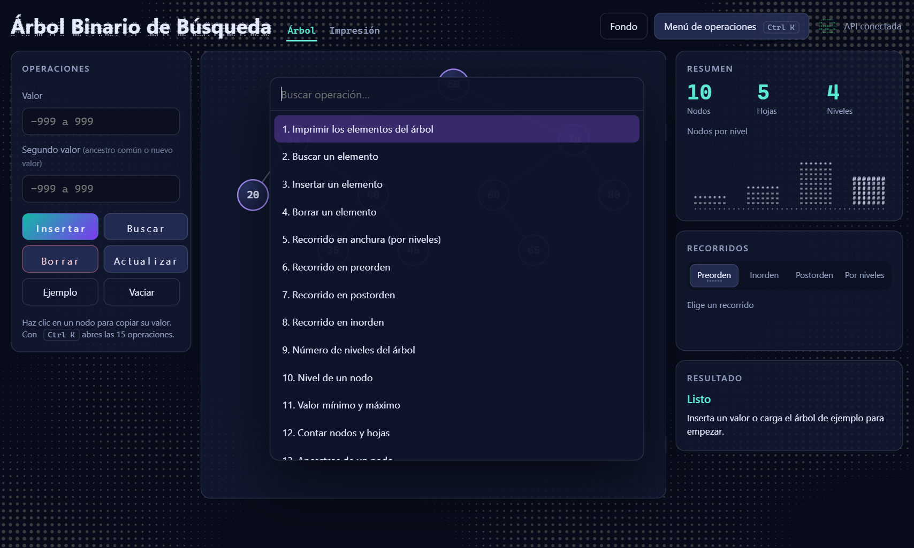

### 9.2 Operación 1: imprimir los elementos del árbol

Muestra el árbol girado hacia la izquierda, con el hijo derecho arriba y el izquierdo abajo, y una sangría de cuatro espacios por nivel. Al abrirla, la vista cambia con la transición de página de Asciify.

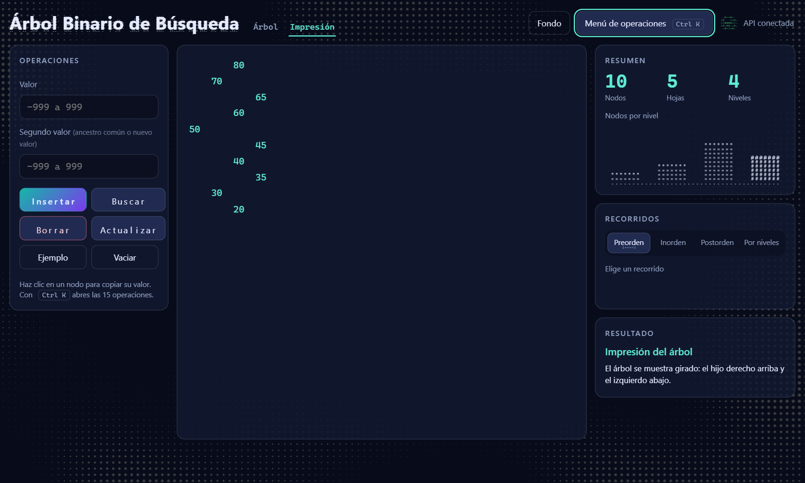

### 9.3 Operación 2: buscar un elemento

La búsqueda resalta la ruta desde la raíz, nodo por nodo. Si encuentra el valor lo marca en verde y el panel de resultado indica el nivel y la ruta. Si no lo encuentra, marca en rojo el último nodo visitado.

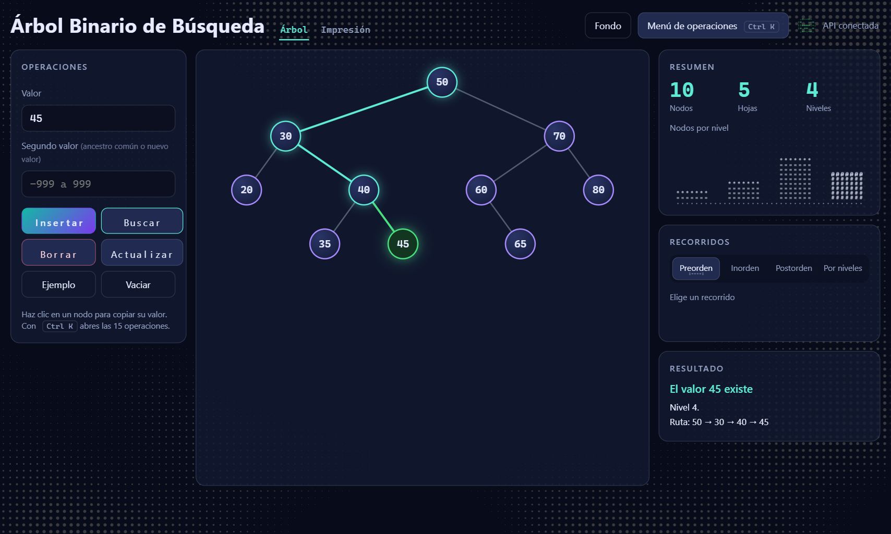

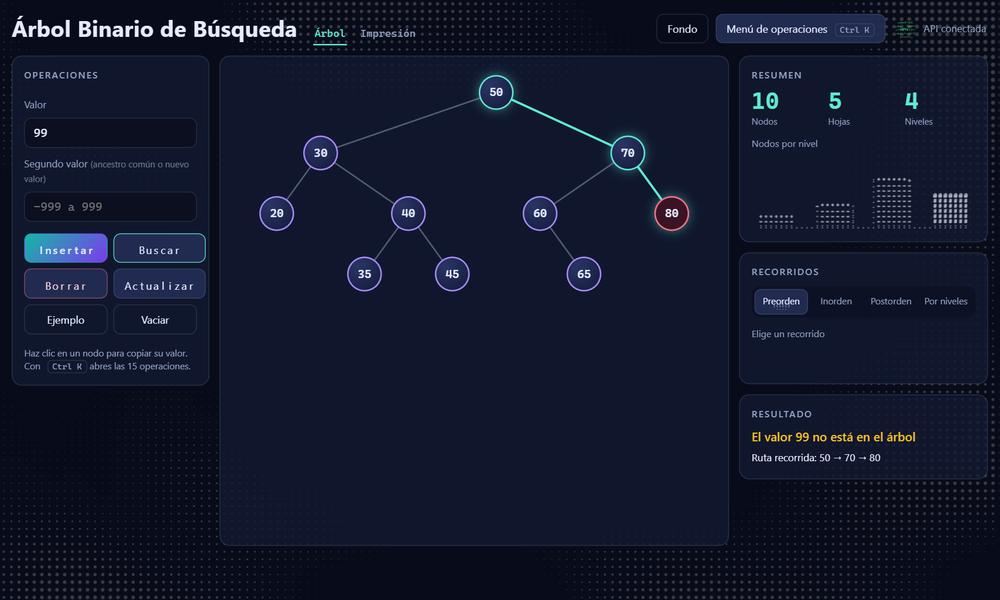

### 9.4 Operación 3: insertar un elemento

Primero se recorre la ruta de inserción sobre el árbol actual. Después aparece el nodo nuevo con una pequeña animación y el resto del árbol se reacomoda.

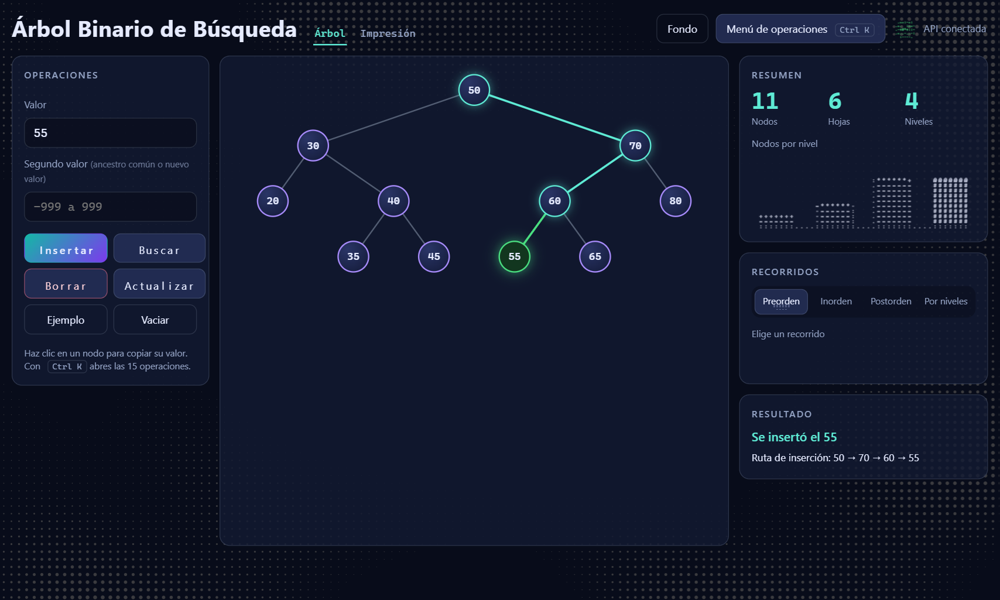

### 9.5 Operación 4: borrar un elemento

Se resalta la ruta hasta el nodo y se marca el nodo objetivo en rojo. Cuando tiene dos hijos se recorre además el camino hasta su sucesor inorden, en amarillo. Después el nodo se deshace en caracteres (componente `disintegrate`) y el árbol se vuelve a dibujar con la respuesta de la API.

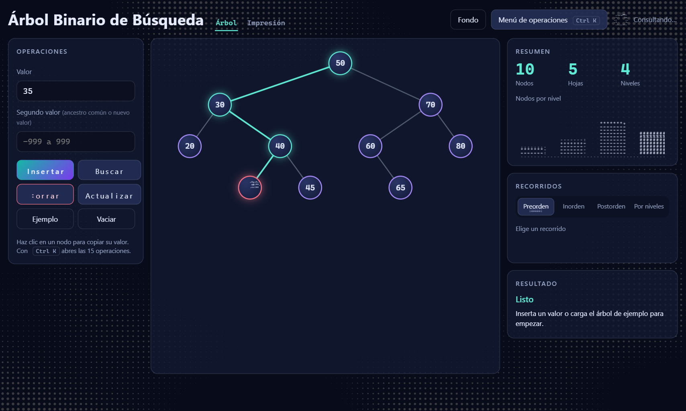

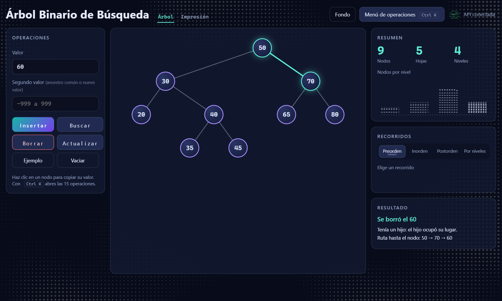


### 9.6 Operaciones 5 a 8: recorridos

Cada recorrido numera los nodos en el orden de visita sobre el árbol y deja la lista de valores como una fila de pastillas en el panel de recorridos. La pestaña activa se sincroniza con la operación que se elija en el menú.

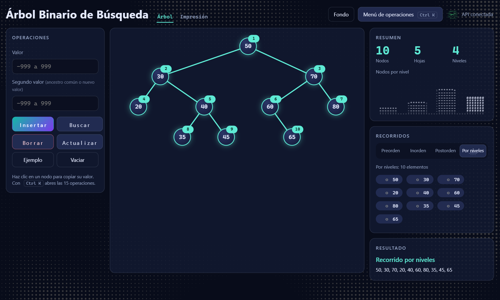

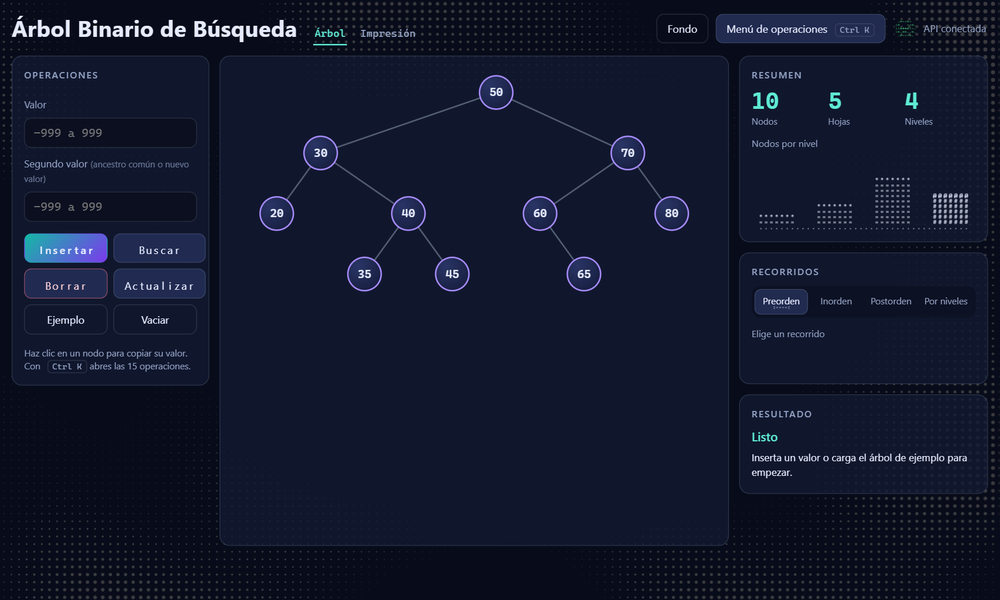

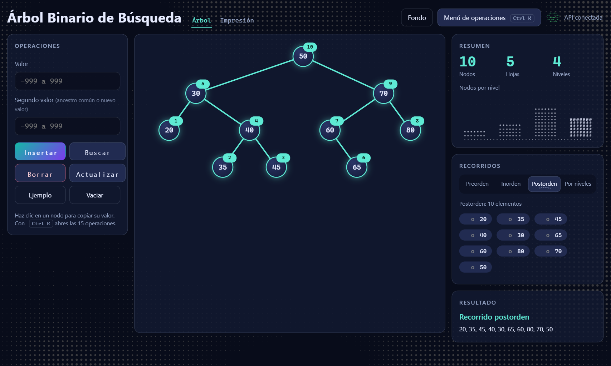

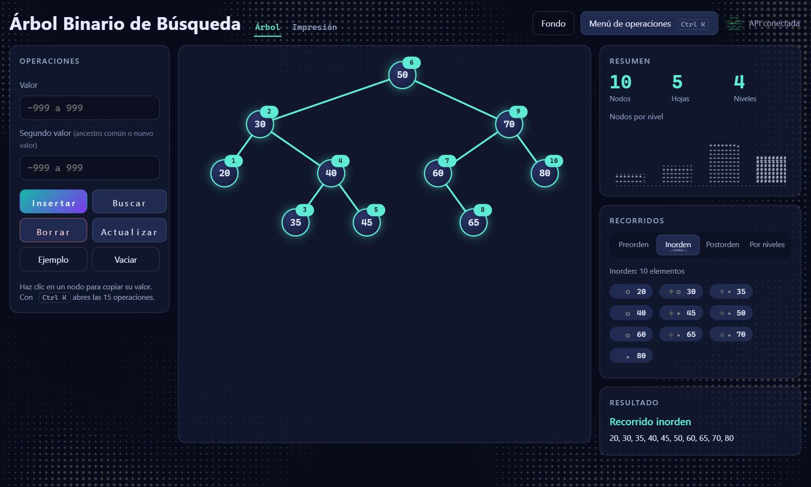

### 9.7 Operación 9: número de niveles del árbol

Informa el número de niveles y cuántos nodos hay en cada uno. La gráfica del resumen muestra esa misma distribución.

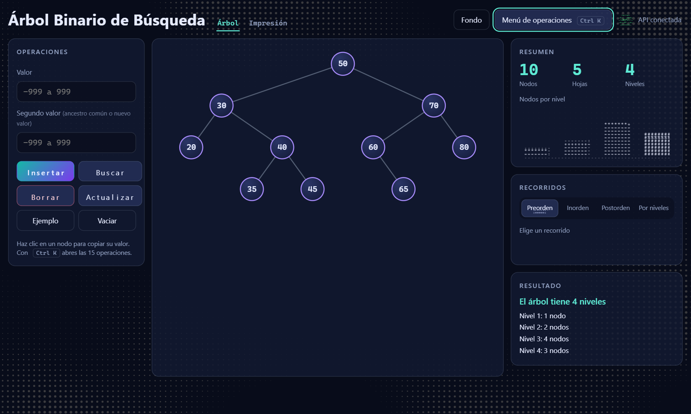

### 9.8 Operación 10: nivel de un nodo

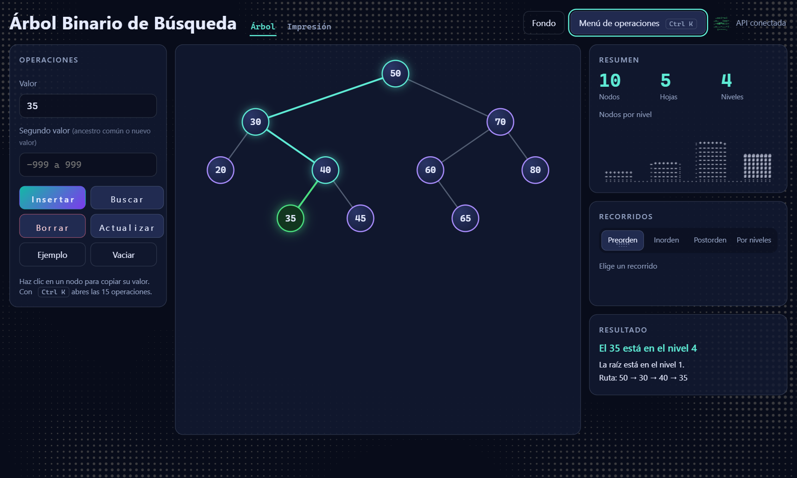

### 9.9 Operación 11: valor mínimo y máximo

Recorre primero la rama izquierda hasta el mínimo y luego la derecha hasta el máximo, y los marca en verde.

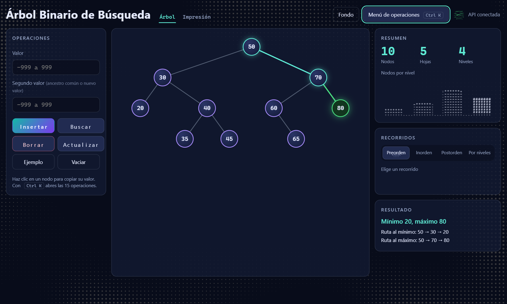

### 9.10 Operación 12: contar nodos y hojas

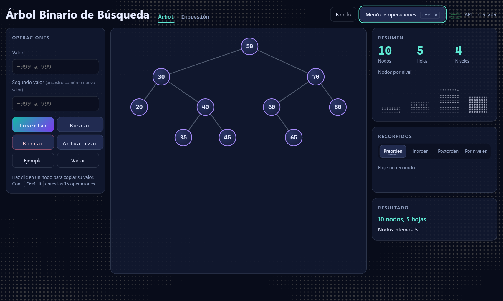

### 9.11 Operación 13: ancestros de un nodo

Muestra el camino desde la raíz hasta el padre del nodo. Para la raíz devuelve una lista vacía, y para un valor que no existe responde 404.

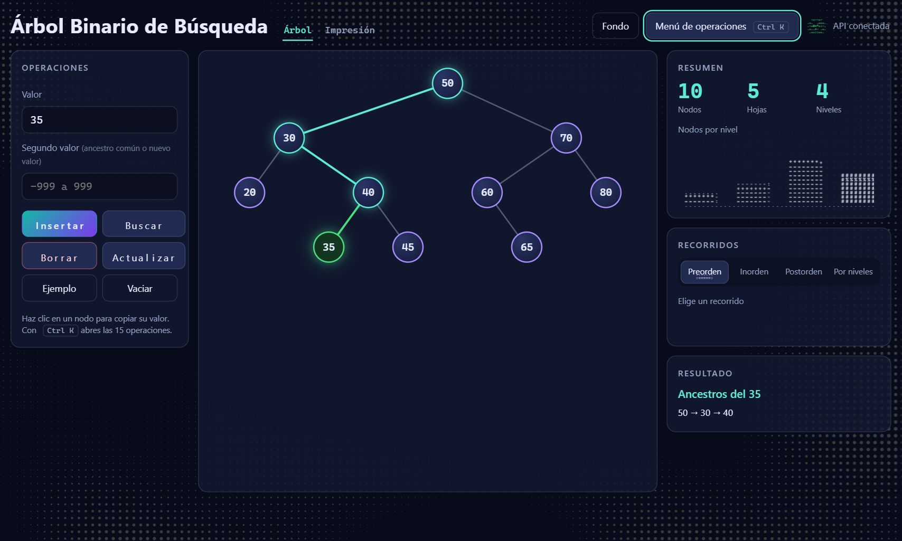

### 9.12 Operación 14: verificar si el árbol está balanceado

Usa el criterio AVL: en cada nodo, la diferencia entre la altura del subárbol izquierdo y la del derecho debe ser como máximo 1. El número sobre cada nodo es su factor de equilibrio, en verde si cumple y en rojo si no.

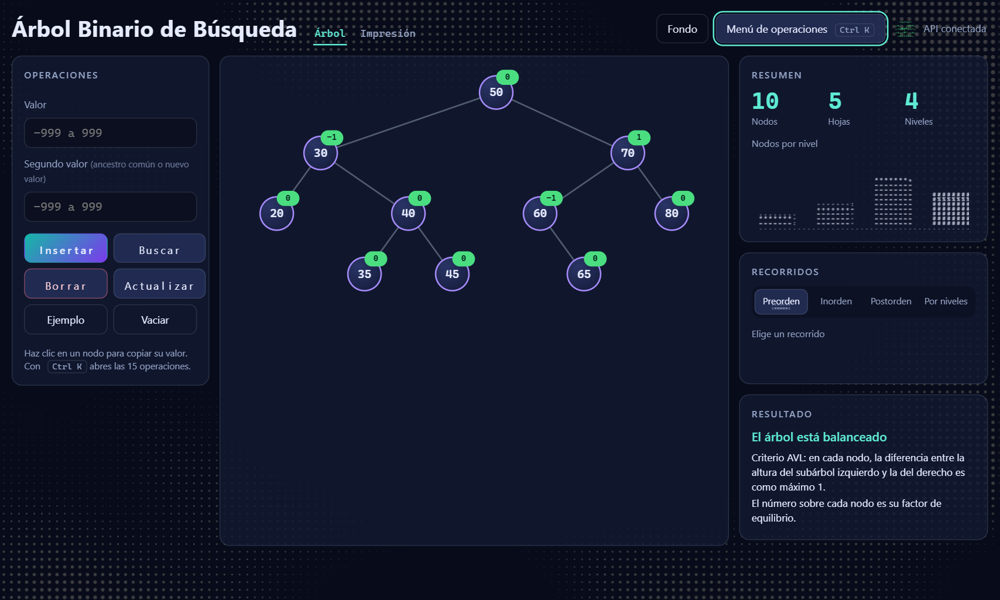

### 9.13 Operación 15: ancestro común más bajo

Dados dos valores, devuelve el nodo más profundo que es ancestro de ambos. Si uno de los valores es ancestro del otro, el resultado es ese valor. Si falta alguno, responde 404 e indica cuál.


### 9.14 Vista en teléfono

En pantallas angostas el escenario del árbol pasa arriba y los paneles se apilan debajo.

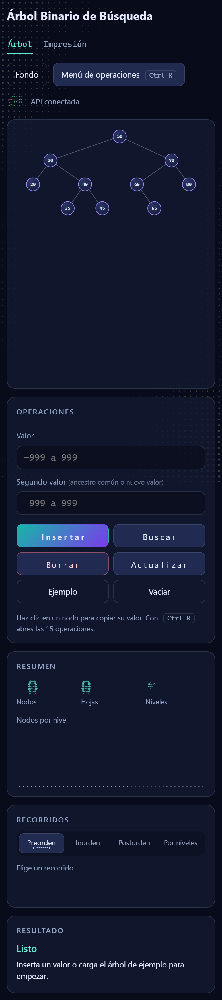

## 10. Pruebas realizadas y resultados

**Pruebas automáticas.** El proyecto `Abb.Tests` tiene 82 pruebas y todas pasan (`dotnet test`). Son 50 de modelo y servicios y 32 de integración sobre la API con `WebApplicationFactory`.

- Modelo y servicios: inserción con ruta, duplicados, búsqueda, los tres casos de borrado (incluido el de la raíz y el de un sucesor con hijo derecho), los cuatro recorridos contra resultados calculados a mano, niveles, extremos, estadísticas, ancestros, balance, ancestro común, el árbol vacío en cada operación y el tope de 1000 nodos.
- SOLID: un recorrido nuevo se agrega sin tocar el código existente, y el servicio se usa por sus dos interfaces pequeñas.
- API: los códigos 200, 201, 400, 404 y 409, el formato `problem+json`, los valores no válidos (ausente, decimal, desbordado, texto y fuera de rango) y una cadena degenerada de 200 niveles que se serializa sin error.

**Pruebas en el navegador.** La aplicación se recorrió completa en Chrome con GPU: las quince operaciones, el cambio de vista, la paleta y las pestañas. La consola quedó sin errores en esa pasada. Con un renderizador por software, el `blockChart` falló, y por eso se añadió el respaldo con barras. Después de una revisión se endureció el controlador del cliente: si una animación falla, el árbol se dibuja de todos modos con la respuesta del servidor, y el borrado limita la espera de `disintegrate` a 1,8 segundos.

**Lo que no se comprobó.** No se probó en Firefox, Safari ni en un teléfono real (la vista móvil es una captura a 390 px). No se hizo una revisión formal de navegación solo con teclado más allá de lo que trae la biblioteca, ni se verificó el comportamiento con `prefers-reduced-motion` activado. Tampoco hubo pruebas de carga. Las aristas se animan con la propiedad CSS `d`, que no se probó fuera de Chrome. Si otro navegador no la anima, las líneas saltarían en lugar de deslizarse.

**Diferencias respecto al plan.** El borrado con dos hijos anima el nodo borrado, no el del sucesor: como los nodos se identifican por su valor, el 80 se desplaza de forma natural a la posición del 70 una vez que se redibuja el árbol. Las figuras 23 y 24 son diagramas dibujados y no capturas. La numeración de las figuras de este documento sigue el orden de aparición.

## 11. Limitaciones

- El árbol vive en la memoria del servidor. Al reiniciarlo se pierde, y todas las personas que abran la aplicación ven el mismo árbol.
- Los valores van de -999 a 999 y el árbol admite 1000 nodos como máximo.
- El árbol no se rebalancea. Insertar valores ordenados produce una cadena, y la operación 14 lo detecta pero no lo corrige.
- Los efectos de Asciify dependen de WebGL2 con GPU. Sin ella no se montan sus canvas. Solo la gráfica por nivel tiene un respaldo propio, y el comportamiento del resto de la interfaz en ese caso no se verificó.
- Swagger está activo solo en el entorno de desarrollo.
- Con más de unos 40 nodos (la cifra depende del ancho de la ventana) hay que desplazar el escenario, porque el escalado tiene un mínimo para que los números sigan siendo legibles.
- Los nodos del árbol son elementos `div` que solo responden al clic. No se pueden enfocar, así que no se elige un nodo con el teclado.

## 12. Conclusiones

La aplicación cumple las quince operaciones pedidas con una estructura que separa el modelo, los controladores y las vistas en el servidor y en el cliente. Mantener la estructura de datos fuera del transporte HTTP permitió probarla sin levantar el servidor, y las 82 pruebas dieron confianza para cambiar el borrado y las consultas mientras se construía la interfaz.

Dos decisiones resultaron más importantes de lo previsto. La primera fue devolver el árbol como lista plana, porque el límite de profundidad del serializador habría roto las cadenas largas. La segunda fue que el cliente no calcule nada del árbol: la vista siempre se redibuja a partir de la respuesta de la API. Como el árbol está en la memoria del servidor y se comparte, otra pestaña puede cambiarlo y esa vista no lo notará hasta su siguiente petición.

Queda pendiente verificar la aplicación en otros navegadores y dispositivos, revisar la accesibilidad con más detalle y, si el uso lo pide, rebalancear el árbol con rotaciones AVL.

## 13. Referencias

- Cormen, T. H., Leiserson, C. E., Rivest, R. L. y Stein, C. *Introduction to Algorithms*. MIT Press. Capítulo sobre árboles binarios de búsqueda.
- Microsoft. Documentación de ASP.NET Core. https://learn.microsoft.com/aspnet/core (consultada en noviembre de 2026).
- Asciify. Componentes y documentación de `asciify-engine` 4.33.0. https://asciify.org/components (consultada el 18 de noviembre de 2026).
- Repositorio del proyecto: https://github.com/Juulren/ABB.git
